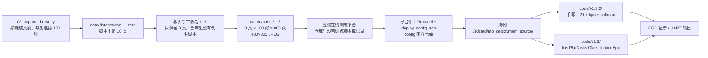

# 04_number_classification —— 数字分类：800 张图 → 一个 kmodel → 两代部署脚本

这一层是一条完整的“数据 → 模型 → 上板”链，位于 `02_data_collection` 的下游、`06_practice` 的上游。它的价值不在识别 8 个数字有多难，而在于整条链能在一个目录里看完。
读法建议：**读 `v1.2.2` 看细节，跑 `v1.3` 更短**。前者手写 `ai2d → kpu → softmax`，后者把同样的事交给 `libs.PlatTasks.ClassificationApp`。
训练那一环不在本仓库，补法见 [docs/04](../docs/04_official_resources.md)；缺陷只给条目号，详见 [docs/02](../docs/02_known_issues.md)。

## 这里有什么

| 文件 | 做什么 | 关键 API | 备注 |
| --- | --- | --- | --- |
| `code/v1.2.2/cls_image_1_2_2.py` | 单图分类，全流程手写 | `image.Image` / `to_numpy_ref` / `nn.ai2d` / `nn.kpu` | 145 行；结果写回 `mp_deployment_source/` |
| `code/v1.2.2/cls_video_1_2_2.py` | 视频流分类：双通道 + OSD + UART | `PIXEL_FORMAT_RGB_888_PLANAR`、`Display.bind_layer`、`uart2.write` | 191 行；含手写 `softmax()` / `sigmoid()` |
| `code/v1.3/cls_image_1_3.py` | 同一件事的 v1.3 写法 | `from libs.PlatTasks import ClassificationApp` | 63 行 |
| `code/v1.3/cls_video_1_3.py` | 视频版 v1.3 | `PipeLine` + `ClassificationApp` | 75 行；默认 HDMI（P2-5） |
| `mp_deployment_source/can2_10.0l_20250704203609.kmodel` | 训好的分类模型，约 2.6 MB | — | **目录名硬编码，不能改** |
| `data/dataset/1..8/` | 训练集：8 类 × 100 张 = 800 张 | — | 480×320 JPEG，由 `02` 采集后板外改名 |
| `data/test_images/1..8.png` | 8 张单图自检输入 | `cls_image_1_3.py` 的输入 | 419×554 至 482×576 的 RGBA PNG，和训练集不是一套 |
| `docs/README.pdf` | 平台自带的两页部署说明 | — | 只讲部署，不讲训练 |

数据链路可以一句话概括：`02_capture_burst.py` 按键切类别、每类连拍 100 张（脚本里是 `one`…`zero` 共 10 类），板外手工改名成 `1..8` 只保留 8 类，得到 800 张 480×320 JPEG；训练在嘉楠在线平台完成，仓库里只留下导出件。**从采集到部署的链路如图，训练与配置这两段在仓库外。**

### 两版脚本的六步对照

| 步骤 | `cls_video_1_2_2.py`（191 行，看得见） | `cls_video_1_3.py`（75 行，看不见） |
| --- | --- | --- |
| 取帧 | 自己开 chn2、设 RGB888P、判 `RGBP888` | `pl.get_frame()` |
| 预处理 | 自己 `nn.ai2d()` + `set_resize_param` + `build()` | `cls_app.config_preprocess()` |
| 显示层 | 自己 `bind_info` + `bind_layer` + 独立 OSD 层 | `pl.show_image()` |
| 推理 | `set_input_tensor` → `run` → 遍历输出 | `cls_app.run(img)` |
| 判定 | 手写 `softmax()` / `sigmoid()` + `argmax` | 封装在 `ClassificationApp` 里 |
| 输出 | 自己 `uart2.write('!'+label+'@')` | 只有画面 |

要改后处理、改上报协议、换输入分辨率，得看 `v1.2.2`；只想尽快看到结果，用 `v1.3`。

### 两个硬约定

- `mp_deployment_source/` **名字不能改**。部署脚本用 `root_path = "/sdcard/mp_deployment_source/"` 硬编码找它，改名后报的是读 json 那一行的 `FileNotFoundError`，看不出是目录名的问题。`data/dataset/1..8` 同理，数字目录名就是类别标签。
- `deploy_config.json` **不在仓库、磁盘上也没有**（P3-2）。脚本从它读 `kmodel_path`、`categories`、`confidence_threshold`、`img_size`、`num_classes` 五个键；没有它，连模型都不会加载。新克隆要自己造一份，字段对照脚本的读取处。

### 测试图为什么要单独放

`data/test_images/` 的 8 张是 RGBA PNG、尺寸 419×554 至 482×576，和 480×320 JPEG 训练集不是一套。它们只用于“拿一张干净数字图戳一下模型”的端到端自检；结果不理想时，先怀疑预处理与分布偏移，不要直接归因于模型。

### 训练这一环

仓库里没有训练脚本、超参记录、数据划分或训练曲线。kmodel 来自嘉楠在线训练平台，本目录只保留导出件；平台操作与训练资料统一收在 [docs/04](../docs/04_official_resources.md)。`deploy_config.json` 是导出件里最接近训练记录的一份文件，但仓库里没有原件可核对。

### 版本怎么选

先看固件：按官方定位选对应版本，v1.2.2 固件用 `code/v1.2.2/`，v1.3+ 用 `code/v1.3/`；两代都可以读，但不要混着跑。再看屏幕：`v1.3` 默认 HDMI，庐山派 800×480 MIPI 屏要改 `"lcd"`。最后看导出包：没有 `deploy_config.json` 就先把配置补齐，否则两个版本都停在第一行。

## 能不能跑

链路是完整的（800 图 → kmodel → 两代脚本），但缺 `deploy_config.json`，所有部署脚本第一步就会失败（P3-2）；仓库里没有训练脚本或训练记录；两个视频脚本都是裸循环（P1-4）；`cls_video_1_3.py:30` 默认 `"lt9611"`，只有 ST7701 屏要改成 `"lcd"`（P2-5）；`cls_video_1_2_2.py:166` 写死 `score >= 0.7`（P3-20）；两代单图脚本要求的 `test.jpg` 路径不同，文件也不在仓库（P2-5）。全部**未上板验证**。

## 练习

1. **用 v1.3 跑 8 张测试图**（`data/test_images/`，逐张拷成脚本要求的路径）。
   建议验收：8 张至少 6 张正确，并能对错的那两张说出是预处理问题还是分布偏移。
2. **自采 8 类数据集**，复用 `02_capture_burst.py` 的骨架。
   建议验收：每类 100 张、480×320、目录名 `1..8`，且总数为 800。
3. **按 `docs/04` 的训练资料在平台训一个模型**。
   建议验收：拿到新的 `*.kmodel` 与 `deploy_config.json`，键名和现有脚本读取的字段一致。
4. **解释 `deploy_config.json`**（如果你的导出包带它）。
   建议验收：逐个字段指出被哪个文件的哪一行读取、读进哪个变量、最后被谁使用。

## 相关

- [CanMV-K230 文档主页](https://www.kendryte.com/k230_canmv/zh/main/index.html)（切到你的固件版本）
- [01Studio 在线模型训练](https://wiki.01studio.cc/docs/canmv_k230/machine_vision/train/)
- 本仓：[docs/04 官方资源](../docs/04_official_resources.md) · [docs/02 已知问题](../docs/02_known_issues.md) · [02_data_collection](../02_data_collection/README.md)
