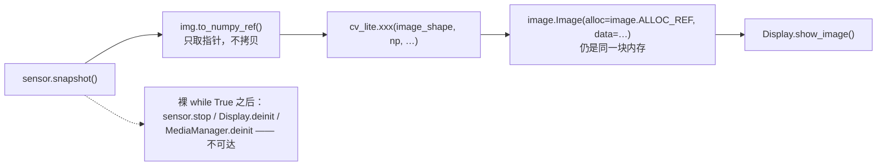

# 05_cv_lite —— 用 `cv_lite` 做实时预处理：27 个官方例程

这一层解决“Python 层逐帧调 image 方法帧率上不去”的问题，位于 `01_basics` 的图像处理之后、`06_practice` 的整机程序之前。`cv_lite` 是**嘉楠官方模块**，把二值化、形态学、模糊、直方图、白平衡和 blobs/circles/edges/rectangles 检测放到固件里，对 ndarray **原地**处理。
27 个文件全部来自嘉楠官方 `/sdcard/examples/23-CV_Lite/` 例程。它的文档从 **v1.4** 才有（v1.3 文档树里没有），页面注明“请烧录 daily_build 固件”；全仓共 **33 个文件** `import cv_lite`。
本目录每个文件只演示一个函数，适合“扫一眼就知道接口形状”，不适合直接当整机程序。

## 这里有什么

三张表覆盖 27 个文件。编号系列 `01_`–`16_` 与命名系列 `grayscale_*` / `rgb888_*` 覆盖同一批算法，是同一教程两个阶段的产物，不是彼此的别名。

### 编号系列 `01_`–`16_`

| 文件 | 做什么 | 关键函数 |
| --- | --- | --- |
| `01_grayscale_binary.py` | 灰度图定阈值二值化 | `grayscale_threshold_binary` |
| `02_rgb888_binary.py` | RGB888 二值化 | `rgb888_threshold_binary` |
| `03_rgb888_exposure.py` | 手动增益调曝光 | `rgb888_adjust_exposure` |
| `04_rgb888_exposure_fast.py` | 快速调曝光 | `rgb888_adjust_exposure_fast` |
| `05_rgb888_erode.py` | 腐蚀 | `rgb888_erode` |
| `06_rgb888_dilate.py` | 膨胀 | `rgb888_dilate` |
| `07_rgb888_open.py` | 开运算（去噪点） | `rgb888_open`（`threshold_value=0` 走 Otsu，P3-11） |
| `08_rgb888_close.py` | 闭运算（补断线） | `rgb888_close` |
| `09_rgb888_tophat.py` | 顶帽 | `rgb888_tophat` |
| `10_rgb888_blackhat.py` | 黑帽 | `rgb888_blackhat` |
| `11_rgb888_morph_gradient.py` | 形态学梯度 | `rgb888_gradient`（函数名无 `morph_`） |
| `12_rgb888_mean_blur.py` | 均值模糊 | `rgb888_mean_blur_fast` |
| `13_rgb888_gaussian_blur.py` | 高斯模糊 | `rgb888_gaussian_blur_fast` |
| `14_rgb888_histogram.py` | RGB 三通道直方图（3×256 数组） | `rgb888_calc_histogram` |
| `15_rgb888_wb_gray_world.py` | 灰度世界白平衡（带参） | `rgb888_white_balance_gray_world_fast_ex` |
| `16_rgb888_wb_white_patch.py` | 白补丁白平衡（带参） | `rgb888_white_balance_white_patch_ex` |

### 灰度检测系列

| 文件 | 做什么 | 关键函数 |
| --- | --- | --- |
| `grayscale_find_blobs.py` | 灰度阈值连通域 | `grayscale_find_blobs` |
| `grayscale_find_circles.py` | 灰度霍夫圆 | `grayscale_find_circles` |
| `grayscale_find_edges.py` | 灰度 Canny | `grayscale_find_edges` |
| `grayscale_find_rectangle.py` | 灰度矩形（Canny + 轮廓逼近） | `grayscale_find_rectangles`（文件名单数、函数复数） |

### RGB 检测系列

| 文件 | 做什么 | 关键函数 |
| --- | --- | --- |
| `rgb888_find_blobs.py` | RGB 空间色块（阈值是六元组，不是 LAB，P3-14） | `rgb888_find_blobs` |
| `rgb888_find_circles.py` | RGB 霍夫圆 | `rgb888_find_circles` |
| `rgb888_find_edges.py` | RGB Canny | `rgb888_find_edges` |
| `rgb888_find_rectangles.py` | RGB 矩形 | `rgb888_find_rectangles` |
| `rgb888_calc_histogram_1.py` | 直方图早期版本（初始化自相矛盾，P3-14） | `rgb888_calc_histogram` |
| `rgb888_white_balance_gray_world_fast.py` | 灰度世界白平衡（无参） | `rgb888_white_balance_gray_world_fast` |
| `rgb888_white_balance_white_patch.py` | 白补丁白平衡（无参） | `rgb888_white_balance_white_patch` |

### 零拷贝链路

`snapshot()` 拿到的帧不复制：`to_numpy_ref()` 只取指针，`cv_lite` 原地处理，`image.Image(..., alloc=image.ALLOC_REF, data=…)` 包回的仍是同一块内存，最后交给 `Display.show_image()`。

```python
img = sensor.snapshot()
img_np = img.to_numpy_ref()                 # 指向相机 buffer，不是副本
out_np = cv_lite.xxx(image_shape, img_np)   # C 侧原地读写
img_out = image.Image(image_shape[1], image_shape[0], image.RGB888,
                      alloc=image.ALLOC_REF, data=out_np)
Display.show_image(img_out)
```

参数顺序要注意：`image_shape = [480, 640]` 是**高在前**，而 `image.Image()` 收的是 **(宽, 高)**，所以写的是 `image.Image(image_shape[1], image_shape[0], …)`。这个下标用法是本目录最容易抄错的地方。



副作用要记清：对 `img_np` 的原地修改就是改相机 buffer；`img.draw_rectangle()` 画上去的内容也会进入送进 `cv_lite` 的数据。

### 三张表怎么用

先按输入格式选系列：灰度输入走 `grayscale_*`，RGB888 走 `rgb888_*`；编号系列是单函数的“最小示例”，命名系列是带完整检测循环的“能直接看结果”。同一个算法在两套里可能对应不同入口，抄之前先确认函数名，不要靠文件名猜。

### 27 个文件的共同前提

`cv_lite` 由固件提供，仓库里没有；`image` 名字来自 `from media.sensor import *`，27 个文件都没有显式 `import image`，别把星号导入删掉。文件里还普遍带着 `Pin` / `_thread` / `ulab` 的死导入，看到它们不代表有 GPIO 或多线程逻辑。

### 两套系列已分叉

编号版用带参的 `_ex` 白平衡（`15_`/`16_`），原名版用无参版（`rgb888_white_balance_*`），这是两个入口点，不是同函数的不同写法（P3-5）。现场要调增益上限就用编号版；`find_*` 系列以命名版参数更全。跨系列复制最危险：无参版粘进项目不报错，只会让颜色偏且无处可调。

## 能不能跑

27 个文件都只依赖固件里的 `cv_lite`，不缺仓库文件；但都是裸 `while True`，清理代码不可达，中断后要断电（P1-4）；全部 `Display.VIRT`，接 LCD 不显示（P3-14）；`Display.init` 的 `quality=` 有三种写法（P3-10）。全部**未上板验证**。

## 练习

1. **跑 `01_grayscale_binary.py`，用 `clock.fps()` 记帧率**。
   建议验收：连续运行 3 次，每次都有画面和 fps 数字，且你能说出输入分辨率与 `image_shape` 的对应关系。
2. **同一目标对比 `05_erode` / `07_open` / `11_gradient`**。
   建议验收：三张结果图的差异能用形态学定义解释，并指出 `07` 的输入阈值与其他两份不同（P3-11）。
3. **把 `01` 复制一份（不要改原件）补 `try/finally` + `exitpoint`**，收尾模板见 [docs/01](../docs/01_getting_started.md)。
   建议验收：IDE 停止后能立即再次运行，不需要断电；原件保持不变。
4. **用 `03` / `04` 对比曝光调节速度**。
   建议验收：同一场景下记录两份的帧率与亮度变化，说明“快速版”快在哪里。

## 相关

- [`cv_lite` 手册](https://www.kendryte.com/k230_canmv/zh/v1.5/api/cv_lite/cv_lite.html)（v1.4–v1.7 有，v1.3 没有）
- [CanMV-K230 文档主页](https://www.kendryte.com/k230_canmv/zh/main/index.html)
- 本仓：[docs/02 已知问题](../docs/02_known_issues.md) · [docs/03 学习路线](../docs/03_learning_roadmap.md) · [docs/01 上手](../docs/01_getting_started.md)
