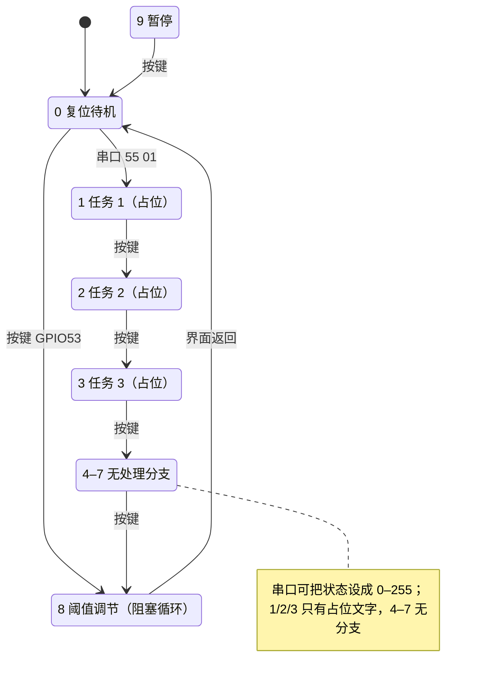

# 06_practice —— 能直接改成赛题程序的骨架

这一层是"看懂 API"到"写得出赛题代码"之间的那一步：8 个板子上跑的脚本 + 1 个浏览器仿真器 + 4 个 LVGL 示例，共同构成一套可复用的工程骨架 —— 带状态机、带按键/串口双通道切换、带触摸屏 LAB 阈值在线标定、带 UART 帧封装、带 PID 巡线闭环。
`01_basics/` 告诉你某个 API 长什么样，`05_cv_lite/` 告诉你预处理有多快，这一层告诉你**这些东西怎么在一个 4 天做完的程序里共处**。

## 这里有什么

| 文件 | 演示什么 | 关键 API | 备注 |
| --- | --- | --- | --- |
| `01_all_in_one.py` | **本仓库最该复用的一份**：状态机骨架 + 触摸屏在线调阈值 | `TOUCH(0)` `tp.read()` `find_rects()` `binary()` `uart2.readinto(Rxbuf, 5)` | 542 行；ST7701 800×480；状态 0/1/2/3/8/9 |
| `02_key_switch_ui.py` | 同一骨架的"纯按键"版：0–3 四态循环 + 状态卡 | `handle_key_state_switch()` `display_state_info()` `uart2.any()` | 640×480 + `Display.VIRT`；触控被注释掉 |
| `03_nested_rect.py` | **内外框判别**：面积排序取前二，角点按顺时针归一化 | `find_rects(threshold=int(rect_area_threshold*1.5))` `rect.corners()` | 含激光点追踪并真的调 `send_data()` → 走到就崩（P0-2） |
| `04_triangle.py` | **两阶段时序**：识别三角形 → 3 秒倒计时 → 转激光追踪 | `find_lines()` `detect_triangle_and_generate_path()` `find_blobs(RED_THRESHOLD)` | 同样真的调 `send_data()`（P0-2）；关键字传参（P2-12） |
| `05_polygon_from_lines.py` | 从**离散线段**反推多边形顶点、边数、类型 | `find_line_segments()` + `extend_line()` `find_polygon_vertices()` `classify_polygon_type()` | 246 行纯 Python 几何；是 `get_regression` 路线的反例 |
| `06_curve_recognition_WIP.py` | 曲线识别 —— **不可用**，见下 | `to_grayscale()` `gaussian(2)` `find_edges(EDGE_CANNY, …)` `get_pixel()` | 689 行；原作者在文件名里就写了"有问题" |
| `08_color_line_following.py` | 四色可切换的 PID 巡线 + 电机帧输出 | `find_blobs([th], roi=下半屏)` `calculate_pid()` `struct.pack('<BHH', …)` | KP=1.2 KI=0.1 KD=0.3 BASE=400；负速度会崩（P2-7） |
| `08_line_following_sim.html` | `08_color_line_following.py` 的浏览器仿真器：画布 + PID 滑条 + 帧 hex | 纯 JS（Canvas 2D） | 双击即开；只仿真控制环，见下 |
| `lvgl/01_lvgl_demo.py` | LVGL 基础控件 + PNG 动画 + 多语言字体 | `import lvgl as lv` `lv.font_load()` | HDMI；缺资源（P3-4） |
| `lvgl/02_lvgl_touch.py` | LVGL + 自写触摸输入设备驱动 | `lv.indev_create()` `set_read_cb()` | 800×480；缺资源；缺 `import uctypes`（P3-17） |
| `lvgl/03_lvgl_freetype.py` | LVGL + FreeType 中文矢量字体 | `lv.freetype_init()` `lv.freetype_font_create()` | 唯一需要 `.ttf` 的一份 |
| `lvgl/first.py` | ⚠️ **不是 LVGL 代码**：随机彩色文字 demo，两份脚本首尾拼接 | `draw_string_advanced` `urandom.getrandbits()` | 见 P3-6；保留理由见 [docs/07](../docs/07_maintenance.md#4-刻意保留的文件真实情况) |

### `01_all_in_one.py` 是什么

不是"一个综合示例"，是一份**赛题程序模板**：

- **状态机**：0 = 复位待机，1/2/3 = 任务位（现在只有 `draw_string_advanced` 占位），8 = 阈值调节，9 = 暂停等串口。你的赛题代码就填在 1/2/3 那三个 `elif` 里。
- **双通道切换**：GPIO53 按键本地切（含 50 ms 消抖 + 等释放）；UART2 远端切（收 5 字节 `55 XX FF FF FF`，`XX` 就是新状态码）。比赛时队友在 MCU 侧发一条命令就能让 K230 换任务。
- **`handle_threshold_adjustment()`（128–426 行）**：左右分屏的触摸标定 UI —— 左边实时二值化预览，右边滑块面板（LAB 6 个、灰度 2 个）。赛场上你没时间改代码重烧，只有时间拖滑块，所以这 300 行是这份模板最该保留的部分。
  ⚠️ 它有两个问题：预览给每个通道减了 128、保存却是原值（[P1-8](../docs/02_known_issues.md#p1-8)）；这个循环不读按键，只能靠界面里的返回按钮退出。

### `06_curve_recognition_WIP.py` 为什么是"不可用"而不是"有 bug"

原作者对它的判断写在**文件名**里。读完 689 行后的结论是：问题不是某个参数没调好，是**架构选错了**，调参救不回来。

- **第 201 行那个阈值匹配所有像素。** `curve_binary_threshold = [(30, 255)]` 被当 6 元组消费成 `(0, 255, -128, 127, -128, 127)`：L 从 0 到 255、A/B 覆盖整个定义域 —— 每个像素都是前景。那个双重循环必然扫遍全图，注释里"降阈值以检测更精细曲线"的意图从来没生效。
- **`gaussian(2)` 是偶数核。** 高斯核需要奇数半径；外面套着宽泛的 `except Exception`，失败也只会静默 `return None` —— 表现就是"程序没报错但什么都没检测到"。
- **慢的真正原因不是参数。** 每帧最坏 240 行 × 800 列 = 19.2 万次 `get_pixel()`，加上同样次数的边界判断，约 38 万次 Python 层调用。这是解释器开销，调阈值影响不了。

**正确做法**：用 `01_basics/11_line_following.py` 的 `img.get_regression([(255, 255)])`，逐像素拟合在固件 C 里做；要分段曲线就按行取若干 ROI、每块一次 `get_regression`。这份文件的骨架（状态机、串口收帧、状态卡）是好的，**但 `extract_curve_points()` 整个函数应当替换，不是修补**。

### `08_line_following_sim.html` 仿的是什么

它仿真的是**控制环**，不是识别环：4 组 LAB 阈值声明了但全文没人读，画布上那条线是纯色方块、位置由几何给出，不做像素分类。PID 部分（`kp=1.2 / ki=0.1 / kd=0.3 / baseSpeed=400`、积分限 ±50、速度限 ±1000）与板子上的 `08_color_line_following.py` 逐值一致，所以**调控制参数是有效的**。

⚠️ 但它同时掩盖了板子上的一个致命问题：JS 用位掩码打包负速度，负值能正常出补码；板子上 `struct.pack('<BHH')` 的 `H` 是无符号，同样的值会直接抛异常。**在仿真器里跑得漂亮的参数，上板可能在第一次反向修正时就崩。**

## 能不能跑

- `03`、`04` 走到激光追踪就崩（`struct.pack` 参数少，P0-2）；`01`、`02` 只是定义了 `send_data()`、从没调用，所以错一直潜伏。
- `08` 的 PID 输出转负就崩（无符号 `'H'`，P2-7），且全文没有 `os.exitpoint()`，停止按钮打不断（P1-4）。
- `06` 的骨架能跑，曲线识别不可用（见上）。
- `lvgl/` 三个 demo 缺字体和图片资源，不是代码问题（P3-4）。
- **没有一条上板验证过。**

## 练习

1. **把 `01_all_in_one.py` 改成"任务 1 = 找最大红色色块并打印中心"。** 只改 `elif state == 1:` 那一个分支，不动骨架；用状态 8 的触摸屏把 `RED_THRESHOLD` 调好并保存。
   完成标准：按 GPIO53 → 进调参 → 拖到预览里"只有红杯是白的" → 保存 → 返回 → 按键到状态 1 → 中心坐标随杯子移动；把杯子拿走后不崩、不误报。
2. **复现 `struct.error`，并给你自己的帧格式。** 在 `04_triangle.py` 上跑到激光追踪分支，让它调用 `send_data()`。
   完成标准：贴出异常原文；写出你打算用的帧（几个字节、每字节含义、有无校验），并**在 `08_line_following_sim.html` 底部的帧显示区里排出来对一遍**。
3. **同一根胶带，三种巡线实现，量帧率。** (a) `05_polygon_from_lines.py` 的 `find_line_segments` + 自己拼；(b) `08_color_line_following.py` 的 `find_blobs` 取质心；(c) `../01_basics/11_line_following.py` 的 `get_regression`。
   完成标准：三条都有你量到的 fps，且 (c) ≥ (b) ≥ (a)。若结论相反，把数字贴出来 —— 那说明 (a) 里的关键字确实报错了（P2-12）。
4. **给 `08_color_line_following.py` 做无硬件验证。** 不接电机，只接串口，用 PC 串口助手的 **hex 模式**看输出（不要用 `../pc_tools/serial_plot_monitor.py`：它按浮点文本解析，二进制帧必然失败）。
   完成标准：能看到 `AA 01 xx xx xx xx 55` 形态的帧；直线时左右速度为正，一旦 PID 输出转负，程序抛 `struct.error`。
5. **补 `lvgl/` 的资源缺口，让 3 个 demo 至少跑起来一个。**
   完成标准：`lvgl/03_lvgl_freetype.py` 能在屏上画出中文。先 `ls /sdcard/res/font/` 看固件给了什么，找不到就把 `SourceHanSansSC-Normal-Min.ttf` 拷进去。

## 相关

- [UART 协议](../docs/06_uart_protocol.md) —— `55 XX FF FF FF`、`AA … 55` 这些帧到底长什么样
- [已知问题](../docs/02_known_issues.md) —— 本目录涉及 P0-2、P1-4、P1-8、P2-7、P2-9、P2-12、P3-4、P3-6、P3-15、P3-16、P3-17
- [维护说明 · 为什么编号有空号](../docs/07_maintenance.md#4-刻意保留的文件真实情况)
