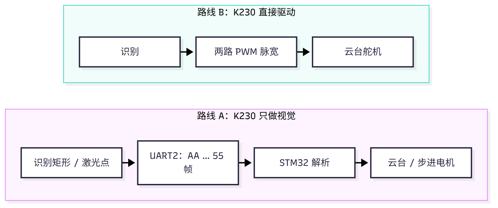

# 2023_E_laser —— 2023 年 E 题「运动目标控制与自动追踪」的视觉端

这一层是 2023 E 题的识别与云台控制代码。题目要求按给定坐标定位激光点、绕铅笔矩形走，并用视觉追踪另一支激光或运动目标；视觉子系统负责找矩形/激光点、做帧间外推，把坐标交给云台。

本目录有两条互不依赖的路线：K230 只做视觉、坐标经 UART 发给 STM32；或 K230 直接用 PWM 驱动舵机云台。两条都能单独成立，读的时候不要混着看。

## 这里有什么

| 文件 | 做什么 | 来源 | 状态 |
|---|---|---|---|
| `main_high_fps.py`（345 行） | 400×240 灰度，`find_blobs` + 一帧速度外推 + 稳定 3 帧；UART2 发 `AA` … `55` 坐标帧；预测点距屏幕中心 (200,120) 小于 30 px 时拉高 GPIO48 | 本仓库 | 读代码核实 |
| `k230_full.py`（463 行） | 800×480，三套颜色阈值，多状态任务机（打点 5 点、追踪、绕框） | 本仓库 | 读代码核实；追踪成功分支见 P1-7 |
| `basic_part.py`（518 行） | 触摸屏离线调 LAB 阈值 + 步进电机 PID；发 `AA AA num dir steps_hi steps_lo sum FF FF` | 第三方教程（bilibili「学不会电磁场」第 14 课） | 读代码核实 |
| `variants/`（6 个） | 同一基础在不同阶段的存档，不是单变量序列 | 本仓库 | 见下 |
| `error/`（4 个） | 失败尝试；`error2`/`error3` 语法不过 | 本仓库 | 归档，P0-5 |
| `reference_gimbal/`（5 个） | K230 直接 PWM 驱动云台（X=GPIO42/PWM0，Y=GPIO52/PWM4，50 Hz），不经串口 | 立创·庐山派例程风格 | 读代码核实 |
| `sample_code/`（2 个） | 亚博例程，依赖 `ybUtils` | 第三方（亚博） | 缺依赖，跑不起来 |
| `yahboom_reference/` | 亚博完整方案，含自带 `menu_threshold_ui/` 4 个脚本 | 第三方，Apache-2.0，署名 Kongcheng | 读代码核实；P3-21 |

两条路线的分工：

### 路线 A 的基准：`main_high_fps.py`

这是后面 2025 年三个 main 的直系祖先，也是本目录最适合先读懂的一份：采集固定 400×240 灰度（`:11-12`、`:168`），串口固定 UART2 @115200（`:39`），屏幕中心写死 (200,120)（`:43-44`）。它的稳定判定只看「连续多少帧落在同一个小邻域」，阈值 3（`:55`、`:268`）；预测用的是最便宜的一帧外推（`:244-248`）。出帧为 `AA` + `struct.pack('<BHH', flag, x, y)` + `55`（`:145`、`:151`），flag 区分「未检出」与「检出」。想改判据时，先在这份上改，再去看 `k230_full.py` 的多状态版本。

### `k230_full.py`：把流程拆成状态

`Situation` 管三档（0 识别、1 开始、2 停止，`:184`、`:252`），`state` 管任务内阶段：先在 `STATE_INITIAL_RESET` 记录 5 个点，再切到 `STATE_DETECT_TARGET`（`:185-223`）。它比 `main_high_fps.py` 多了打点与绕框，但 `Situation == 0` 就干活这一点与 2025 的版本一致，读串口控制时留意。分辨率是 800×480，同一套面积/像素门限在这里要重算，不能从 400×240 直接抄。

### `variants/`：按阶段读，不按文件名读

| 文件 | 这一版在做什么 |
|---|---|
| `k230_entry.py`（456 行） | 早期形态，A4 长宽比过滤的雏形 |
| `k230_basic.py`（418 行） | 基础追踪，两种帧：单点 11 B 与 5 点 23 B |
| `k230_basic_variant2.py`（436 行） | 与 `k230_basic.py` 并列的另一套实现：阈值结构与发帧方式都不同 |
| `k230_basic_done.py`（610 行） | 基础题完成版，`finally:` 之后有死函数（P2-14） |
| `k230_pencil_mark.py`（506 行） | 铅笔线框打点，同样有尾部死函数（P2-14） |
| `yedan.py`（203 行） | 只做内外嵌套矩形检测并 `print`，不发串口；立创例程 |

### `error/`：四次失败尝试

| 文件 | 当时的做法 | 状态 |
|---|---|---|
| `error1.py`（189 行） | VIRT/LCD/HDMI 三种显示分支的早期版本 | 语法通过，方案被 `variants/` 取代 |
| `error2.py`（415 行） | 状态 + 坐标的调试打印，f-string 里是空 `{}` | 语法不过，P0-5 |
| `error3.py`（397 行） | 同 `error2.py` 的另一版 | 语法不过，P0-5 |
| `error4.py`（522 行） | 红/绿/激光三阈值的完整尝试 | 语法通过，被 `variants/` 取代 |

### `sample_code/`：亚博例程，缺依赖

`get_square.py`（232 行）与 `red_light.py`（243 行）都 `from ybUtils.YbKey import YbKey` / `YbUart`（`:5-6`），本仓库没有 `ybUtils` 包，导入即失败。`get_square.py:79` 还引用了未定义的 `light_roi`（P2-16）。这两份适合看流程与按键组织，想真跑要先补亚博的包或自己替换串口/按键封装。

### 路线 B：`reference_gimbal/`

`main.py`（770 行）是菜单式主程序：KEY1(GPIO27) 复位、KEY2(GPIO14) 画正方形、KEY3(GPIO61) 矢量循迹、KEY4(GPIO40) 追踪红绿目标、KEY5(GPIO46) 暂停/继续。它自成一套架构，不发坐标帧；`gimbal_driver.py`（125 行）把舵机驱动抽出来，适合先单独验证「视觉 → 云台转」这一段。

### 第三方件：`yahboom_reference/`

`get_rect.py`（356 行）与 `get_light3.py`（99 行）发 `A3`/`B3` 大端帧；`menu_threshold_ui/` 是它的触摸菜单阈值工具，四个脚本分工如下。

| 文件 | 行数 | 做什么 |
|---|---:|---|
| `main.py` | 88 | 菜单入口与页面切换 |
| `get_rect_ui.py` | 344 | 识别矩形并在屏幕上画框的界面 |
| `change_threshold.py` | 192 | 三组 LAB 阈值的滑块调节与保存；会忽略调用方传入的阈值（[P3-21](../../docs/02_known_issues.md#p3-21)） |
| `otherKey.py` | 40 | 按键扫描 |

本仓库把它当 vendored 代码保留，不修改；要用这套菜单，先自己抄一份再改。

## 能不能跑

没有一份经过上板验证，以下均为读代码核实：

- `k230_full.py`：`:411-414` 的 `beep_pwm` 与 `:359` 的 `Red_thresholds` 未定义，追踪成功那一刻抛 `NameError`；`:59`、`:66` 的 `struct.pack('<BHHHH', …)` 只给了 3 个实参。→ [P1-7](../../docs/02_known_issues.md#p1-7)、[P0-2](../../docs/02_known_issues.md#p0-2)
- `variants/`：3 个文件在 `finally:` 之后有 100–166 行死函数，另有 5 处未定义名。→ [P2-14](../../docs/02_known_issues.md#p2-14)、[P2-16](../../docs/02_known_issues.md#p2-16)
- `error/error2.py`、`error/error3.py`：语法不过，只能当文字材料。→ [P0-5](../../docs/02_known_issues.md#p0-5)

## 练习

1. **先写方案，再对照代码。** 只读题面 PDF，写下你会怎么分视觉与控制、用什么帧格式。完成标准：列出至少 5 条设计选择，每条指到本目录一个文件或 [docs/06](../../docs/06_uart_protocol.md) 的一条约定；与两条路线不一致的地方写明理由。

2. **三个主脚本各跑一遍，比较帧率与鲁棒性。** 同一目标、同一光照下，记录 `main_high_fps.py`、`k230_full.py`、`basic_part.py` 的屏幕 FPS 与丢失目标次数。完成标准：交出一张三行表；未上板就在每格写「未验证」，不要填估计值。

3. **修 `beep_pwm` 之前先确认蜂鸣器引脚。** 先在原理图或立创官方资料里找到蜂鸣器对应的 GPIO/PWM 通道。完成标准：写明引脚号与出处；找不到就写「未核实」并停手——不要猜通道（见 P1-7）。

4. **把 `variants/` 当阶段存档读。** 按代码实际内容判断先后与并列，而不是按文件名。完成标准：每个文件一句话说明「这一版新增或放弃了什么」，指向具体函数或常量；能指出哪两版是并列分支而非先后关系。

5. **抓一帧看字节序。** 用 USB-TTL 接 UART2，跑 `main_high_fps.py`，记录检出与未检出各一帧的原始字节。完成标准：能指出 `AA`、`55`、flag、x/y 的位置与字节序，并与 [docs/06](../../docs/06_uart_protocol.md) 的约定逐项对照；未上板就写「未验证」，不要凭代码推一个「应该」的字节序列当结果。

## 相关

- 题面：`E题_运动目标控制与自动追踪系统.pdf`；同一份在 `../../NUEDC_TOPIC-master/真题/2023/`。
- 缺陷与状态：[docs/02](../../docs/02_known_issues.md)；串口帧：[docs/06](../../docs/06_uart_protocol.md)；学习路线：[docs/03](../../docs/03_learning_roadmap.md)。
