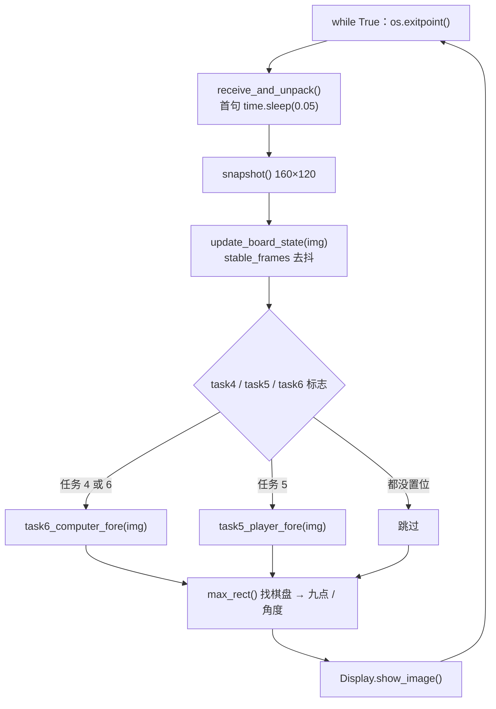

# 2024_E_tic_tac_toe —— 2024 年 E 题「三子棋游戏装置」的视觉与棋局逻辑

这一层做三子棋装置的 K230 端：视觉识别棋盘外框与九个棋格的落子状态，判断玩家是否违规取子/落子，用 Alpha-Beta 搜索选出电脑落点，再通过 UART 把坐标或状态交给执行机构。

执行机构（落子伺服）不在本仓库。视觉子系统负责棋盘定位、九点栅格、黑白棋子判定与去抖；棋局逻辑负责规则与选点。

## 这里有什么

| 文件 | 做什么 | 来源 | 状态 |
|---|---|---|---|
| `main_tic_tac_toe.py`（1503 行） | 完整方案：160×120 采集、棋盘 ROI、九点栅格、`stable_frames` 去抖、Alpha-Beta、任务 1–6 分支、UART 收发 | 本仓库 | 读代码核实；启动路径见 P0-1 |
| `skeleton_incomplete.py`（244 行） | 同方案的骨架，只留函数壳，`receive_and_unpack()` 函数体为空且 `:184` 语法不过 | 本仓库 | 归档，P0-5 |
| `E题_三子棋游戏装置.pdf` | 官方题面 | 官方 | — |

主循环每帧的顺序：

### 按函数读 `main_tic_tac_toe.py`

行号只标已用 `grep -n` 核对过的定义位置；改代码后请重新定位。

| 函数 | 做什么 |
|---|---|
| `receive_and_unpack()`（:316） | 逐字节扫 `FF … FE`，解析任务/子任务并置标志；首句 `time.sleep(0.05)`（P1-9） |
| `update_board_state(img)`（:673） | 逐格开小 ROI 判有无棋子与颜色，用 `stable_frames` 去抖后写 `board` |
| `find_best_move(board)`（:797） | 对每个空格试落，返回评分最高的 `(row, col)` |
| `computer_move(board)`（:812） | 调 `find_best_move()` 并改 `board`，但既不返回也不发送坐标（P2-2） |
| `task5_player_fore(img)`（:1056） | 任务 5：玩家回合的落子确认与违规判定 |
| `task6_computer_fore(img)`（:1191） | 任务 6：电脑回合，取九点坐标并组织发帧 |
| `draw_board(img, maxrect, lines)`（:252） | 在画面上画棋盘边框与九宫格线 |
| `cal_roi(maxrect)`（:266） | 由棋盘矩形推出九个棋格的小 ROI |

### 棋盘怎么变成九个格子

`max_rect(img)` 在固定 ROI `roi_qipan` 上跑 `find_rects(threshold=8000)`（`:167-169`），取面积最大的矩形；`cal_ninepoints(rect)`（`:194`）按角点插值出九宫格中心；`cal_roi(maxrect)` 再给每格开一个更小的 ROI。`threshold=8000` 是像素阈值，棋盘距离、纸面反光、环境亮度都会影响它，换场地要重新确认。每格的落子状态再由 `update_board_state()` 用 `stable_frames` 去抖（阈值 10 帧），所以「看到子」与「认这颗子」之间隔着约 10 帧。

### 棋子的颜色与去抖

黑白各一组 LAB 阈值（`:86-87`），板面固定 3×3（`:89`），`PLAYER='X'`、`COMPUTER='O'`（`:92-93`）。`stable_frames` 每格一个计数器，连续 10 帧同结论才写进 `board`（`:95-97`）。这个 10 直接决定「人摆好子」到「程序认子」的延迟；调小会让反光和手影混进来，调大则回合节奏变慢。

### 对外发的三种帧

`send_data()`（`:285`）按任务 ID 分支，帧都是 `FF | 任务ID | 数据 | FE`：

| 任务 ID | 数据 | 用途 |
|---|---|---|
| `0x02` | 两个 `<f` float32（x、y） | 告诉执行机构落子坐标 |
| `0x03` | 两个 `<H` 无符号整数（棋盘 9 位状态、棋子 9 位状态） | 上报当前棋局 |
| `0x05` | 一个 `0xAA` | 复位指令 |

坐标和状态都是小端；对端若按大端解析，数值会明显不对，排查时先看这里。

### 建议的阅读顺序

先看 `max_rect()` 怎么找棋盘、`cal_roi()` 怎么切格子，再看 `update_board_state()` 怎么把一格判成黑/白/空——这三步决定了整局输入是否可信。之后读 `minimax()` 与 `find_best_move()`，最后看 `task5_player_fore()` / `task6_computer_fore()` 怎么把棋局结论变成串口帧。`draw_board()` 只影响调试画面，可以最后看。

### `skeleton_incomplete.py`：为什么不能当起点

它保留了 `float_to_bytes` / `build_frame` / `get_chess_presence_status` / `get_chess_color_status` / `max_rect` / `send_data_frame` / `send_data` / `receive_and_unpack` 八个函数壳（`:96`、`:100`、`:104`、`:113`、`:123`、`:137`、`:142`、`:173`），但 `receive_and_unpack()` 的函数体是空的，`:184` 紧跟一个缩进错误的 `frame_counter = 0`，整文件过不了语法解析（P0-5）。它适合用来看接口命名，不适合直接补全。

### Alpha-Beta 在讲什么

井字棋状态空间小，可以搜到底：谁赢、还是平局。极小极大搜索假设双方都走对自己最有利的一步：

- 轮到电脑（`is_maximizing=True`）：每个空格试填 `O`，递归取**最大**分值。
- 轮到玩家（`is_maximizing=False`）：同样试填 `X`，但取**最小**——对手不会让你舒服。
- 叶子打分：电脑赢 `+1`、玩家赢 `−1`、平局或到深度上限 `0`（`minimax()` 在 :759，默认 `max_depth=4`）。
- 顶层 `find_best_move()` 就是「哪个空格的返回值最大就下哪」。

剪枝维护两个边界：`alpha` 是我方能保证的下界，`beta` 是对手允许的上界。搜索中一旦 `beta <= alpha`，这条分支的后续已经不可能影响最终选择，直接 `break`，整棵子树不看。

这套 `alpha/beta` 骨架在井字棋里省的是常数，换到更大的棋盘才有指数级意义。读的时候留意三点设计取舍：`max_depth=4` 不是完全求解；评分只有 `±1/0`，没有「占中心」「连成两颗」这类局面分；`find_best_move()` 的 `alpha`/`beta` 在候选之间不更新，所以顶层实际没剪枝，剪枝只发生在递归内部。

## 能不能跑

没有一份经过上板验证，以下均为读代码核实或在代码里可直接看到的结构：

- `main_tic_tac_toe.py` 缺显式 `import os`，却在 `:1446` 调 `os.exitpoint()`。→ [P0-1](../../docs/02_known_issues.md#p0-1)（待上板确认）
- `receive_and_unpack()` 每帧 `sleep(0.05)`，帧率上限被这一行压住。→ [P1-9](../../docs/02_known_issues.md#p1-9)
- 悔棋/取子检测不可达；`computer_move()` 不返回也不发送；RGB 灯只初始化；任务 3 先到时 `board_angle` 未定义。→ [P2-1](../../docs/02_known_issues.md#p2-1)、[P2-2](../../docs/02_known_issues.md#p2-2)、[P2-13](../../docs/02_known_issues.md#p2-13)、[P2-15](../../docs/02_known_issues.md#p2-15)
- `skeleton_incomplete.py` 语法不过，不要拿它当起点。→ [P0-5](../../docs/02_known_issues.md#p0-5)

## 练习

1. **只加一行 `import os`，让主循环真正跑起来。** 把文件另存为临时文件，在导入段补 `import os`，不要改原文件。完成标准：屏幕上出现棋盘 ROI 框与九点标记，终端里不再有 `NameError`；记录此时 FPS，并指出它的上限由哪一行决定（P1-9）。未上板就写「待上板」。
2. **用真实棋盘跑一局。** 摆好棋盘，依次落子到平局，记录每一步的 `board`、九个状态位与串口帧。完成标准：9 步都有对应记录，且最后一步的胜负/平局判定与人工判断一致；未上板就整题写「待上板」。
3. **解释 Alpha-Beta 剪枝。** 不用术语堆砌，讲清一次具体的 `break`：哪一层、哪个边界越过了谁、被砍掉的子树原本会返回什么。完成标准：能对着 `minimax()` 的 `if beta <= alpha:` 指出两处位置，并说明为什么此时可以安全放弃。
4. **指出那两处死代码本来想干什么。** 一处是 `stable_frames` 的负值分支（P2-1），一处是 `computer_move()` 的落点（P2-2）。完成标准：各写一句「作者原本想让它做什么」，再写「要生效最少改哪里」；不要顺手改原文件。
5. **给 `receive_and_unpack()` 做非阻塞改造。** 先用一个最小脚本测试当前固件的 `uart.any()` 是否存在且可用（`any()` 不在官方手册的方法列表里，见 [P3-25](../../docs/02_known_issues.md#p3-25)）。完成标准：记录测试结果；可用则给出改造后的读包逻辑与帧率对比，不可用则写明原因并保留 `sleep`；未上板的部分标「未验证」。
6. **把本题的帧和另外两题放在一起看。** 本题用 `FF … FE` 包任务 ID 与 float32/位状态，2023 与 2025 用 `AA … 55`，STM32 例程又有自己的 `AA + len + checksum`。完成标准：画出三种帧的字节布局对照（标出字节序与校验方式），并说明哪一种最容易在接收端半包时重同步；结论指到 [docs/06](../../docs/06_uart_protocol.md) 的具体小节。

## 相关

- 题面：`E题_三子棋游戏装置.pdf`；同一份在 `../../NUEDC_TOPIC-master/真题/2024/`。
- 缺陷与状态：[docs/02](../../docs/02_known_issues.md)；帧格式与各题差异：[docs/06](../../docs/06_uart_protocol.md)。
