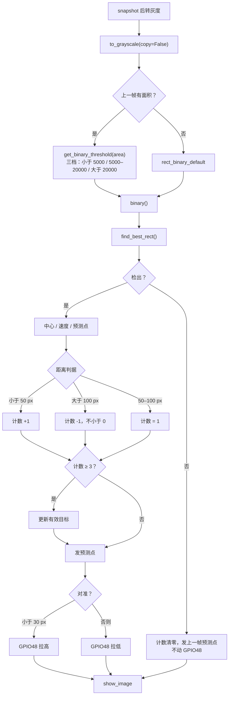
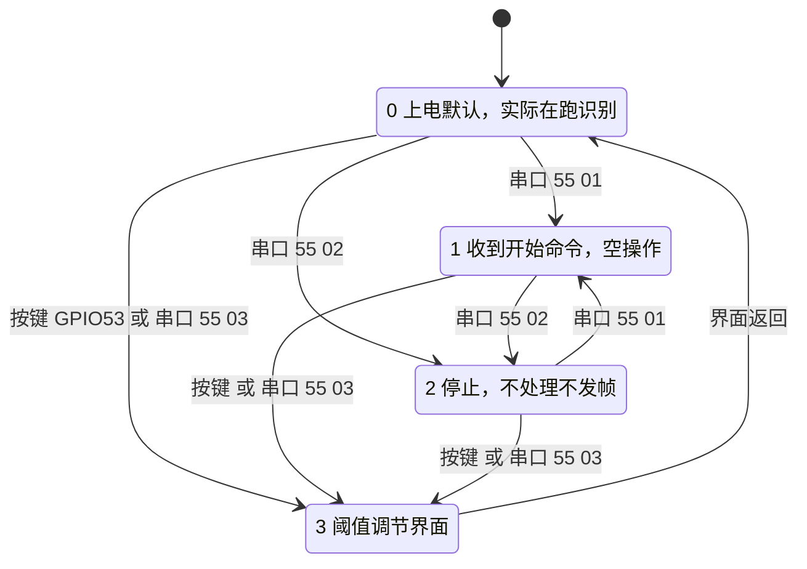

# 2025_E_self_aiming —— 2025 年 E 题「简易自行瞄准装置」的原创方案

这一层是本仓库作者从零写的赛题代码：摄像头识别 A4 靶面上的矩形标志，算出中心并做一帧外推，当预测点足够靠近屏幕中心时点亮激光，同时把坐标发给 STM32。

视觉子系统承担全部识别与预测；云台/瞄准机构由外部电控或 `find_rect/` 之外的机构完成。三个 `result/` 主程序是同一条流水线的三种取舍。

## 这里有什么

| 文件 | 做什么 | 来源 | 状态 |
|---|---|---|---|
| `result/main_thresh_ui_fast.py`（655 行） | 手写矩形筛选 + 触摸屏阈值 UI + `Situation` 状态机；帧率优先 | 本仓库原创 | 读代码核实；P1-2、P1-3、P2-11 |
| `result/main_thresh_ui_accurate.py`（987 行） | `cv_lite` 的 Canny + 轮廓 + 自写 3×3 透视变换；精度优先 | 本仓库原创 | 读代码核实；P1-6 |
| `result/main_multi_constraint.py`（451 行） | 嵌套矩形判据 + 一维卡尔曼；无 UI、无状态机 | 本仓库原创 | 读代码核实；P1-1 |
| `find_rect/`（4 个脚本 + 1 个模型） | 作者训练的 AnchorBaseDet kmodel（7.2 MB）与嘉楠平台导出脚本，`README.pdf` 是部署说明 | 模型由本仓库作者训练；脚本为平台导出件 | 读代码核实；P2-5 |
| `methods_reference/iterations/`（9 个） | 走到最终方案前的阶段存档，其中 1 个是逐字节重复 | 本仓库原创 | 读代码核实 |
| `methods_reference/error/`（2 个） | 废弃方案（同心圆靶标 / 打点与目标同帧） | 本仓库原创 | 归档 |
| `E题_简易自行瞄准装置.pdf` | 官方题面 | 官方 | — |

### `result/` 三个 main 怎么选

| 版本 | 取舍 | 代价 |
|---|---|---|
| fast | `find_blobs` + 几何过滤，不依赖 `cv_lite`；带触摸 UI，现场能改阈值 | UI 会覆盖标定值（P1-2）；开始命令是空操作（P1-3） |
| accurate | `cv_lite` 的 Canny + 轮廓 + 透视变换，几何筛选更严 | 依赖固件模块 `cv_lite`；三处走到即崩（P1-6） |
| multi | 嵌套矩形 + 卡尔曼平滑，理论上抗干扰最好 | 招牌判据恒真，实际跑的是 `find_best_rect()` 回退路径（P1-1）；无 UI、无电控状态机 |

### `find_rect/` 的四个脚本

| 文件 | 做什么 |
|---|---|
| `det_image_1_2_2.py`（149 行） | CanMV v1.2.2 单图推理，手写 `nncase_runtime` + `ai2d` 预处理 |
| `det_video_1_2_2.py`（188 行） | 同上，实时视频版 |
| `det_image_1_3.py`（70 行） | CanMV v1.3+ 单图版，走 `libs.PlatTasks.DetectionApp` 高层封装 |
| `det_video_1_3.py`（80 行） | 同上，视频版 |

四个脚本都读 `/sdcard/mp_deployment_source/deploy_config.json`，该文件是平台导出产物、不在仓库（P3-2）；`det_image_1_3.py:29` 直接读 `/sdcard/test.jpg`。模型要放在 SD 卡根的 `mp_deployment_source/` 下，不是仓库里的相对路径。

### 共享流水线（数值表）

三个 main 都走这条链路；数值逐个文件核对过：

| 环节 | 数值 / 做法 | 核对位置（fast / accurate / multi） |
|---|---|---|
| 分辨率 | `400 × 240`（三个文件都用 `picture_width`/`picture_height` 变量，逐个 grep 核对，无例外） | `:13-14` / `:17-18` / `:11-12` |
| 串口 | UART2，GPIO11=TXD、GPIO12=RXD，115200 | `:45` / `:49` / `:39` |
| 激光 | GPIO48 推挽输出 | `:39` / `:43` / `:37` |
| 三档阈值 | default / small / large；fast `(103,255)`、`(127,216)`、`(85,200)`；accurate `(95,255)`、`(110,216)`、`(80,200)`；multi `(100,255)`、`(127,216)`、`(81,200)` | `:22-24` / `:26-28` / `:20-22` |
| 分档规则 | `area < 5000` → small；`5000 < area < 20000` → default；其余 → large（`area == 5000` 落进 large，P2-6） | `:27` / `:31` / `:25` |
| 用上一帧面积选档 | 上一帧有 `max_rect` 就用它的 `area()`；首帧用 default | `:508-510` / `:799` / `:314` |
| 稳定计数 | 阈值 3；距 `last_valid_target` 小于 50 px 计数 +1，大于 100 px 计数 −1（不低于 0），50–100 px 重置为 1 | `:61` / `:65` / `:55` |
| 一帧预测 | `predicted = center + (center − previous_target)` | `:548-552` / `:874-876` / `:363-367` |
| 开激光判据 | 预测点到屏幕中心 (200,120) 的距离小于 30 px | `:611` / `:937` / `:419` |
| 出帧 | `AA` + `struct.pack('<BHH', flag, x, y)` + `55`，flag 0=未检出、1=检出，共 7 字节 | `:436/442` / `:727/733` / `:235/241` |

识别与打激光的每帧流程：

fast / accurate 还有一套 `Situation` 状态机（multi 没有）。串口 `55 01/02/03` 与按键 GPIO53 的切换关系：

### `iterations/` 与 `error/`

`iterations/` 是阶段存档，不是单变量递进。下表第三列来自当时的笔记，**没有逐版对照代码**，当作线索而不是结论：

| 文件 | 在试什么 | 当时怎么判断（未复验） |
|---|---|---|
| `use_find_rects.py`（246 行） | 直接用固件自带 `find_rects` | 觉得细线方框不稳，放弃 |
| `custom_rect_check.py`（266 行） | `find_blobs` + `min_corners()` + 面积/长宽比 | 被认为可采纳，进 `result/` |
| `custom_rect_check_dup.py`（266 行） | 与上一行逐字节相同（`md5sum` 一致） | 重复存档，读一份即可 |
| `gimbal_rect_roi.py`（288 行） | A4 长宽比过滤 + 闭运算 | 部分采纳；比例过滤被放弃 |
| `gimbal_rect_voting.py`（342 行） | 5 帧滑动窗口投票 | 被认为引入 5 帧延迟，放弃 |
| `gimbal_rect_predict.py`（298 行） | 首次引入一帧外推 + 稳定计数 | 采纳，是三个 main 的直接形态 |
| `gimbal_rect_predict_v2.py`（322 行） | 阈值按面积分三档 | 采纳，连同边界缺陷一起继承（P2-6） |
| `gimbal_rect_opening.py`（307 行） | 用 `cv_lite` 自己做开运算 | 认为固件原生 `open(1)` 更省事，放弃 |
| `cvlite_variant.py`（500 行） | `cv_lite` Canny + 轮廓 + 透视变换 | 采纳为 accurate 的骨架 |

`error/` 两个文件是早期方向：`error1.py`（384 行）把靶标理解成同心圆，`error2.py`（576 行）把打点与目标点放进同一帧；两者接口都与最终约定不符。

`find_rect/` 的 4 个脚本是嘉楠平台导出件，`det_image_1_3.py` 读硬编码的 `/sdcard/test.jpg`，`deploy_config.json` 不在仓库（[P3-2](../../docs/02_known_issues.md#p3-2)）。`README.pdf` 是部署说明，遇到 API 问题先查它，不要猜。

## 能不能跑

没有一份经过上板验证，以下均为读代码核实：

- accurate 版三处走到即崩：`RectLike` 没有 `corners()`、`matrix` 未赋值、`import cv_lite` 模块不在仓库。→ [P1-6](../../docs/02_known_issues.md#p1-6)
- multi 的嵌套矩形判据 `len(outer_points) != 8` 恒真，抗干扰路径从未生效。→ [P1-1](../../docs/02_known_issues.md#p1-1)
- 进阈值 UI 会把标定值覆盖成硬编码默认值。→ [P1-2](../../docs/02_known_issues.md#p1-2)
- `Situation == 1`（开始识别）掉进空分支，上电即识别。→ [P1-3](../../docs/02_known_issues.md#p1-3)
- 丢失目标时不关激光，上一帧点亮就会一直亮。→ [P2-19](../../docs/02_known_issues.md#p2-19)
- 收包长度不一致：fast 用 4 字节（与协议一致），accurate 用 5 字节（命令分支永不成立）。→ [P2-11](../../docs/02_known_issues.md#p2-11)
- 部署脚本 6 处问题（padding 少 1 像素、双斜杠、HDMI 默认值等）。→ [P2-5](../../docs/02_known_issues.md#p2-5)
- `area == 5000` 掉进 large 档。→ [P2-6](../../docs/02_known_issues.md#p2-6)

## 练习

1. **跑 fast，打自建靶。** 在 A4 纸上画一个深色边框矩形，按题面距离摆好。完成标准：能连续看到 `flag=1` 的帧与屏幕 FPS；未上板则整题写「待上板」。
2. **用触摸 UI 标定并保存一次。** 按 GPIO53 进入阈值界面，在真实光照下调到能稳定识别，保存，再打一次靶。完成标准：记录保存前后的 `rect_binary_default` 数值（P1-2 会让你看到它们不一致）；命中时 `dist_to_target < 30` 且激光亮。
3. **演示默认阈值在同样光照下失败。** 不调参，直接在偏暗或偏亮的光照下打同一个靶。完成标准：给出默认阈值与现场阈值的两组数值、各自命中率；说明差异来自哪一档。
4. **对比三个 main 的帧率与鲁棒性。** 同一靶标、同一距离，记录 FPS 与丢失目标次数。完成标准：三行表；multi 需注明它实际走的是 `find_best_rect()` 回退路径；未上板写「未验证」。
5. **用 `det_image_1_3.py` 跑一张自备图。** 把 `test.jpg` 放到 `/sdcard/test.jpg`，模型与 `deploy_config.json` 放到 `/sdcard/mp_deployment_source/`。完成标准：能输出检测框；失败时按 `README.pdf` 与 P2-5 逐项排查，并记录卡在哪一步。
6. **把 `iterations/` 当阶段存档读。** 不按文件名排序，按代码特征排序。完成标准：每个文件一句话「这一版在试什么、结局如何」，并指出哪一个是逐字节重复。

## 相关

- 题面：`E题_简易自行瞄准装置.pdf`；同一份在 `../../NUEDC_TOPIC-master/真题/2025/`。
- 缺陷与状态：[docs/02](../../docs/02_known_issues.md)；串口帧：[docs/06](../../docs/06_uart_protocol.md)；赛前检查：[docs/05](../../docs/05_competition_checklist.md)。
