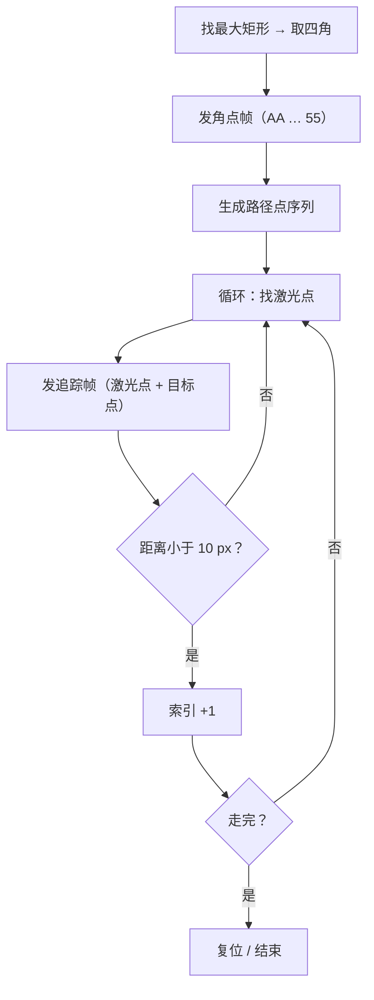

# laser_drawing —— 让激光点按预定轨迹画图形的实验序列

这一层不是赛题，是「让激光（或云台指针）在识别到的矩形里沿矢量路径走」的一组实验：三角形、圆、五角星、贝塞尔曲线，外加一个 LVGL 调参界面和一份浏览器仿真页。序列里多数文件与 [`2023_E_laser`](../2023_E_laser/README.md) 共用同一套硬件和骨架——找最大矩形、生成路径点、逐点发帧、判断到位；差别在于 2023 E 让激光「追目标」，这里让激光「按轨迹走」，是云台打点的前置练习。帧格式统一写在 [docs/06](../../docs/06_uart_protocol.md)，本页不重复帧表。

## 这里有什么

| 文件 | 做什么 | 关键 API / 来源 | 备注 |
| --- | --- | --- | --- |
| `01_triangle.py` | 等边三角形：顶点朝上取三点，每边插值 20 步，逐点推进 | `send_data`（`:56`）、`send_rect_data`（`:65`）、`send_tracking_data`（`:87`） | 序列基准，无额外依赖 |
| `02_triangle_exposure.py` | 在 01 上加曝光压制、高斯预模糊、圆形度筛选 | `import cv_lite`（`:11`）、`cv_lite.rgb888_adjust_exposure`（`:214`） | 4 处 `struct.pack` 参数个数错，见「能不能跑」 |
| `03_circle.py` | 圆，60 / 100 步两档均匀采样 | `generate_circle_path_points`（`:107`） | 无 |
| `04_pentagram.py` | 五角星，5 个顶点按笔画序 `[0,2,4,1,3]` | `PWM` 直驱两轴舵机（GPIO42/PWM0、GPIO52/PWM4，50 Hz，`:22`、`:69`） | 另一套硬件，不发 UART（[P2-10](../../docs/02_known_issues.md#p2-10)） |
| `05_digits_EMPTY.py` | 占位，0 字节，从未实现 | — | 保留理由见 [docs/07](../../docs/07_maintenance.md) |
| `06_bezier.py` | 二次 / 三次贝塞尔：爱心、S 形、正弦 | `bezier_quadratic`（`:109`）、`bezier_cubic`（`:115`）、三个 `generate_*_path`（`:121`、`:178`、`:194`） | 无 |
| `07_ui_debug.py` | LVGL 触摸调参界面，只做识别与显示 | `import lvgl`（`:6`）、`uctypes`（`:10`） | 全文没有 UART 输出 |
| `ui_simulation.html` | 同一界面的浏览器布局仿真 | 纯前端，双击打开 | 不出帧，也不能拷上板 |

### 一条迭代序列，不是七份重复

行级相似度：`01`↔`02` 88%、`01`↔`03` 74%、`01`↔`06` 60%、`03`↔`06` 63%；`04` 换成了 PWM 直驱，属于另一套架构。共同的是骨架，真正换的只有中间的路径生成器。保留多份的理由是每份都能单独丢上板跑，而且依赖各不相同：`02` 要 `cv_lite`，`04` 要舵机云台，`07` 要 LVGL；抽成公共模块会把「只要一个最小可跑版本」这条路弄丢。

发帧这一侧，`01` 的三种帧分别是单个点、四角加中心、激光点加目标点，字节布局见 [docs/06](../../docs/06_uart_protocol.md)。

### 建议的阅读顺序

`01` → `03` → `06` 是三种路径生成器，连着读能看清「只换中间一段」的结构；`02` 是在 `01` 上加视觉预处理，放在后面读可以专心看曝光那部分；`04` 换成 PWM 直驱、`07` 换成 LVGL，各自独立；`05` 是序列里的缺口，补做时从它起步。

### 一次画图形的闭环

代码里的主循环走的就是下面这条链：先定角点，再沿路径逐点追。

## 能不能跑

`01`、`03`、`06` 的主路径读代码核实可走通，但没有上板验证。`02` 会先卡在 `cv_lite` 导入（它是嘉楠官方模块、文档从 v1.4 才有，见 [docs/01 §1](../../docs/01_getting_started.md#1-烧固件)），导入成功后所有发帧路径会撞 4 处 `struct.pack` 参数个数错（`:61`、`:70`、`:75`、`:81`，[P0-2](../../docs/02_known_issues.md#p0-2)）。`04` 需要外接舵机云台，`07` 需要 LVGL 与触摸驱动，`05` 是空文件。当前本目录没有一条已上板验证。

## 练习

1. **跑 `01` 画三角形。**
   任务：接好摄像头与显示，只改中心点和边长，观察三角形起点与靶标的关系。
   验收：屏幕上出现随靶标移动的等边三角形，激光点沿三条边逐点推进；能指出 `interpolation_steps = 20` 在 `:151` 改大后，单圈耗时变长但轨迹更平滑。
2. **用串口助手 hex 模式核对三种帧。**
   任务：让 `01` 跑起来，hex 模式下把三类帧各存一条。
   验收：分别抓到 7 / 23 / 11 字节，帧头 `AA`、帧尾 `55` 正确，坐标字段按小端还原后与屏幕上的点一致；能说出哪一帧对应四角加中心。
3. **跑 `02` 复现 4 处 `struct.error`。**
   任务：在临时副本里依次触发三个发送函数，原文件不动。
   验收：报错为 `pack expected 5 items for packing (got 3)`（或 `6 / 5`），并在报告里说明你选「收窄格式串」还是「补齐实参」，以及为什么前者不会改变线上字节数。
4. **把 `06` 的路径函数换成自己的图形。**
   任务：挑一个简单图形（正方形或字母 L），照样写一个采样函数接进主循环。
   验收：新增一个 `generate_*_path` 并接进主循环，串口侧收到的点数与图形周长成正比；图形首尾闭合处不出现跳变（相邻点距离不超过插值步长）。
5. **先用 `ui_simulation.html` 定 UI 布局，再上板改 `07`。**
   任务：在浏览器里把按钮位置、配色、字号定下来，再逐项对照代码。
   验收：改好的布局能在 `07_ui_debug.py` 的 `draw_ui()`（`:251`）里一一对上；上板后不需要再反复烧录调位置。

## 相关

- [庐山派 K230 引脚查询工具](https://wiki.lckfb.com/zh-hans/lushan-pi-k230/pinout-tutorial.html)（交互式页面，没有静态引脚表）
- [CanMV UART 模块手册（v1.3）](https://www.kendryte.com/k230_canmv/zh/v1.3/api/machine/K230_CanMV_UART%E6%A8%A1%E5%9D%97API%E6%89%8B%E5%86%8C.html)
- [docs/06 串口协议](../../docs/06_uart_protocol.md) · [docs/02 已知问题](../../docs/02_known_issues.md) · [docs/07 维护说明](../../docs/07_maintenance.md)
