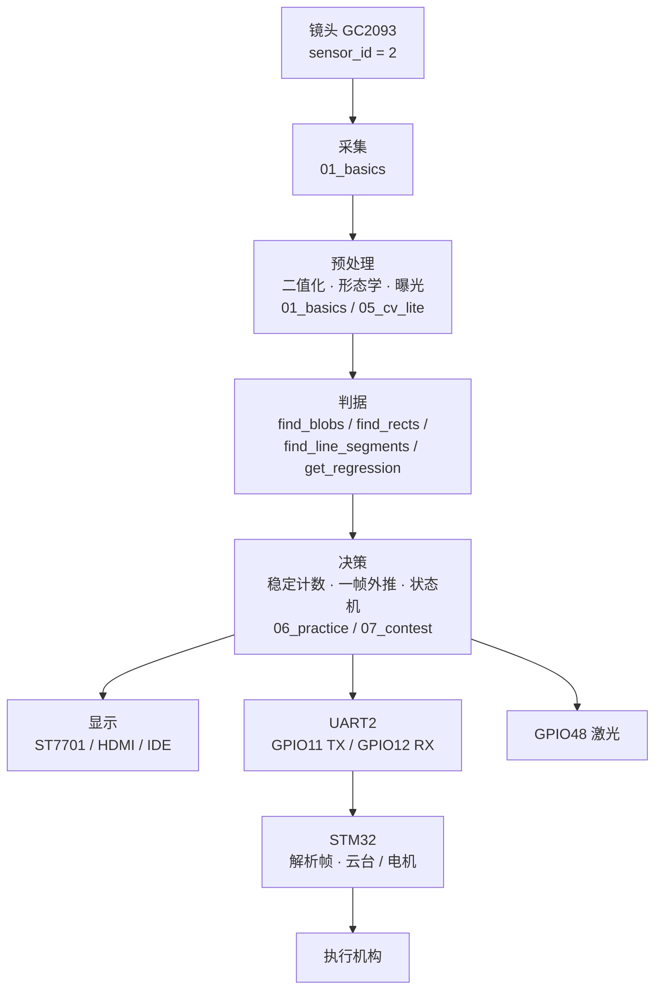
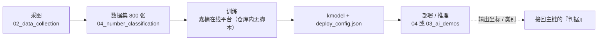
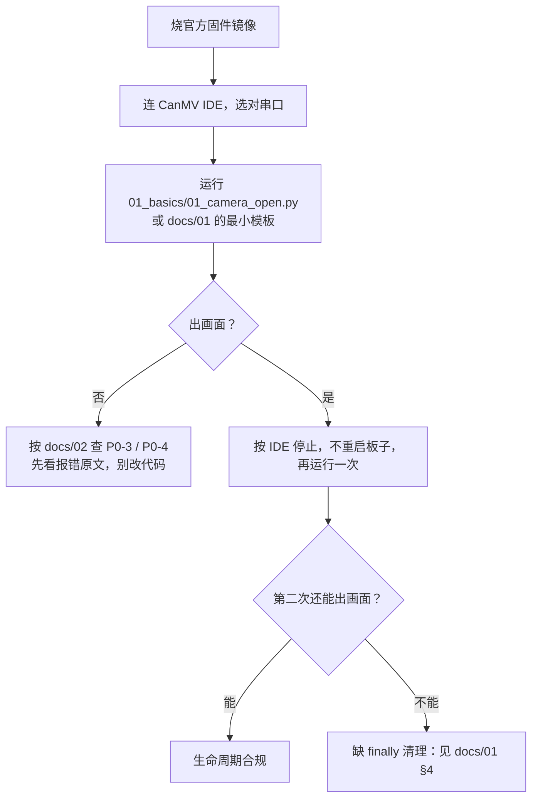

# K230 电赛视觉资料库

嘉楠 **K230**（CanMV / MicroPython）机器视觉代码集，为**全国大学生电子设计竞赛**积累而成：既有从零写的赛题方案，也有基础教程、数据采集、模型部署和历年真题原文。
写给自己、队友和学弟学妹 —— 所以每个目录都有 README，每个结论都标"是怎么知道的"。

| | |
| --- | --- |
| **开发板** | 立创·庐山派 K230-CanMV（`LCKFB-LSPI-K230-1G`，1 GB） |
| **固件** | CanMV **v1.3+**（官方文档在 `kendryte.com`，旧的 `developer.canaan-creative.com` 已跳转） |
| **摄像头 / 屏幕** | GC2093（`sensor_id = 2`）/ ST7701 800×480，可外接 LT9611 HDMI |
| **代码语言** | 板子上是 MicroPython；`other_boards/` 另有 STM32 的 C、OpenMV、MaixPy |

---

## 整体框架：一个赛题视觉系统是怎么拼起来的

这个仓库不是"一堆脚本"，而是按下面这条链组织的。**每个目录对应链上的一环**，看清这条链，就知道为什么有九个目录、以及自己卡在哪一环。

**支线：AI 模型。** 上面的链是"手工判据"，遇到形状复杂、光照多变的目标就不够了。仓库里还有第二条路，它的输出接回"判据"这一环：

两条路的分工：**主链**是"看得懂每一步"的手工判据，调起来快、上限低；**支线**把判据换成一个模型，能处理形状复杂、光照多变的目标，但训练和部署在仓库外。绝大多数赛题是主链 + 少量支线。

> 一句话：**视觉只是 4 天赛制里的一个子系统。** 这条链跑通之后，结构、电源、MCU 联调还要占掉一半天数。别把第三天全花在调一个阈值上。

## 目录一览

| 目录 | 是什么 | 什么时候看 |
| --- | --- | --- |
| [`01_basics/`](01_basics/README.md) | 12 个最小示例：开摄像头、绘制、矩形/线段/圆形、颜色追踪、一维码/二维码/AprilTag、巡线 | 第一次摸板子；忘了某个 API 怎么调 |
| [`02_data_collection/`](02_data_collection/README.md) | 单拍 / 连拍建数据集 / 串口收发测试 | 要训练自己的模型之前 |
| [`03_ai_demos/`](03_ai_demos/README.md) | 人脸、人体、手势、目标跟踪的 kmodel 推理示例（18 个） | 做 AI 题；当 API 结构参考，**不是能直接跑的样板** |
| [`04_number_classification/`](04_number_classification/README.md) | 一个完整的数字分类工程：800 张数据集 + 训好的 kmodel + 两代固件脚本 | 想走通"数据 → 模型 → 上板"整条路 |
| [`05_cv_lite/`](05_cv_lite/README.md) | 27 个 `cv_lite` 图像处理器示例：二值化、曝光、形态学、模糊、直方图、白平衡、blobs/circles/edges/rectangles | 手工判据不稳、要做预处理调优时 |
| [`06_practice/`](06_practice/README.md) | 状态机骨架、内外框/三角形/多边形识别、颜色巡线、LVGL | 开始写自己的赛题程序时，**直接拿 `01_all_in_one.py` 改** |
| [`07_contest/`](07_contest/README.md) | 2021 / 2023 / 2024 / 2025 的赛题代码 + 题目 PDF + 厂商例程 | 备战具体某一年 |
| [`other_boards/`](other_boards/README.md) | **跑不了这块板子的代码**：MaixPy、OpenMV、STM32 Keil 工程 | 找对端实现；或想知道某个算法的原型写法 |
| [`pc_tools/`](pc_tools/README.md) | 跑在电脑上的脚本（串口曲线监控） | 调试上位机 |

`NUEDC_TOPIC-master/` 是 1994–2026 的电赛题目原文（150 个 PDF = 真题 136 + 综合测评 12 + 参考资料 2），已纳入版本控制。[`docs/`](docs/README.md) 是文档层。

## 能不能跑

**这张表只分三档：`已上板验证` / `读代码核实` / `待上板确认`。当前没有一条"已上板验证"** —— 所有"跑不起来""会崩"都是读代码推出来的，不是实测。每个结论的原因、证据和改法都在[已知问题清单](docs/02_known_issues.md)。

| 路径 | 状态 | 说明 |
| --- | --- | --- |
| `01_basics/` | 读代码核实 | 12 个里 11 个能启动；`01` 的关键字已按官方手册修正；`11` 因 `D(90, 23)` 起不来 |
| `02_data_collection/` | 读代码核实 | 4 个都能启动；`03` 的关键字已修；`02` 第 11 次按键会 `OSError`，中断后要断电 |
| `03_ai_demos/` | 待上板确认 | 缺 **26 个**模型/先验资产，一个都不在仓库；v1.3 上能否跑没有结论 |
| `04_number_classification/` | 待上板确认 | 链路完整，但缺 `deploy_config.json`（不在仓库），部署脚本第一步就失败 |
| `05_cv_lite/` | 读代码核实 | 需固件里的 `cv_lite`；27 个都是裸循环，中断要断电 |
| `06_practice/` | 读代码核实 | `03`、`04` 的串口发送路径一调用就 `struct.error`；`01`、`02` 里是潜伏的同款错 |
| `07_contest/` | 待上板确认 | 各年份分别有 1–3 处读到就崩的点，见[目录说明](07_contest/README.md) |
| `other_boards/` | 不是这块板子 | MaixPy / OpenMV / STM32，按平台区分，别照抄 |
| `pc_tools/` | 读代码核实 | 能跑；200 个点后 X 轴塌陷，串口号写死 |

## 五分钟看到第一帧

第二次能直接再跑，说明 `os.exitpoint()` + `finally` 里的清理是完整的。这条"停止后能不能直接再跑"是判断一份 CanMV 脚本写得是否规矩最快的方法 —— 也是本仓库 27 个 `cv_lite` 文件都不合格的地方。

## 学习顺序

| 阶段 | 时间 | 看什么 | 产出 |
| --- | --- | --- | --- |
| 0 环境 | 2–4 h | [docs/01](docs/01_getting_started.md) + `01_basics/01` | 能出画面，且停止后不用断电 |
| 1 图像基础 | 6–10 h | `01_basics/02–07` + `05_cv_lite` | 三种光照下的三组阈值 |
| 2 特征与几何 | 10–16 h | `01_basics/08–12` + `06_practice/02–06` | 巡线、嵌套框、码制识别 |
| 3 串口与闭环 | 8–12 h | `02_data_collection` + `06_practice/01,08` + `other_boards/stm32` | 回环、重同步、云台闭环 |
| 4 AI / kmodel | 12–20 h | `04_number_classification` + `03_ai_demos`（当参考） | 数据 → 训练 → 部署走通一遍 |
| 5 赛题实战 | 20–40 h | `07_contest/` | 一道题端到端做完 |

阶段 0–3 是 **26–42 小时**的"最低可用"备赛量；阶段 4–5 才区分冲奖与否。完整版（每阶段的练习、验收标准、排期、分工）在[学习路线](docs/03_learning_roadmap.md)。

## 官方资源（精选）

| 资源 | 什么时候用 |
| --- | --- |
| [CanMV-K230 官方文档](https://www.kendryte.com/k230_canmv/zh/main/index.html) | 首选。⚠️ 左侧有 v1.2–v1.7 版本选择器，`main` 是开发分支；你在 v1.3 就切到 v1.3 |
| [立创·庐山派 wiki](https://wiki.lckfb.com/zh-hans/lushan-pi-k230/quick-start.html) | 烧固件、引脚、串口、摄像头 |
| [image 图像处理 API（v1.3）](https://www.kendryte.com/k230_canmv/zh/v1.3/api/openmv/image.html) | 任何函数签名争议以它为准 |

全清单（含每条"解决什么问题"、两份官方说法冲突的地方）在 [docs/04](docs/04_official_resources.md)。

## 文档索引

| | |
| --- | --- |
| [docs/README.md](docs/README.md) | 文档总入口 |
| [docs/01_getting_started.md](docs/01_getting_started.md) | 固件、IDE、SD 卡目录、生命周期模板、v1.2 与 v1.3 的差异 |
| [docs/02_known_issues.md](docs/02_known_issues.md) | **缺陷唯一事实源**：按症状查、带证据等级、每条给位置/成因/改法 |
| [docs/03_learning_roadmap.md](docs/03_learning_roadmap.md) | 六阶段、时间预算、练习与验收标准 |
| [docs/04_official_resources.md](docs/04_official_resources.md) | 官方文档与优秀案例全清单 |
| [docs/05_competition_checklist.md](docs/05_competition_checklist.md) | 可打印一页：出发前 / 到场第一小时 / 比赛中 |
| [docs/06_uart_protocol.md](docs/06_uart_protocol.md) | 串口帧族、STM32 解析流程、重同步实现 |
| [docs/07_maintenance.md](docs/07_maintenance.md) | 命名、保留物、旧名总表、许可与出处（给维护者） |
| `*/README.md` | 每个目录一份：这里有什么 / 能不能跑 / 练习 |

## 约定与来源

- **自己写的代码和文档用 ASCII 文件名**（要拷到 FAT32 SD 卡、用 CanMV IDE 打开；纯 ASCII 也避开路径长度问题），**内容和注释保留中文**。
- 三类保持中文原名不动：官方题目 PDF、厂商例程原件（其教程按中文编号引用）、`NUEDC_TOPIC-master/`。
- **代码状态**：除[两处 `Sensor` 关键字拼写](docs/02_known_issues.md#p0-3)按官方手册修正外，全部保持原样；其余缺陷只记录、不修改。出处、许可与"为什么有些文件看起来该删却留着"见 [docs/07](docs/07_maintenance.md)。
