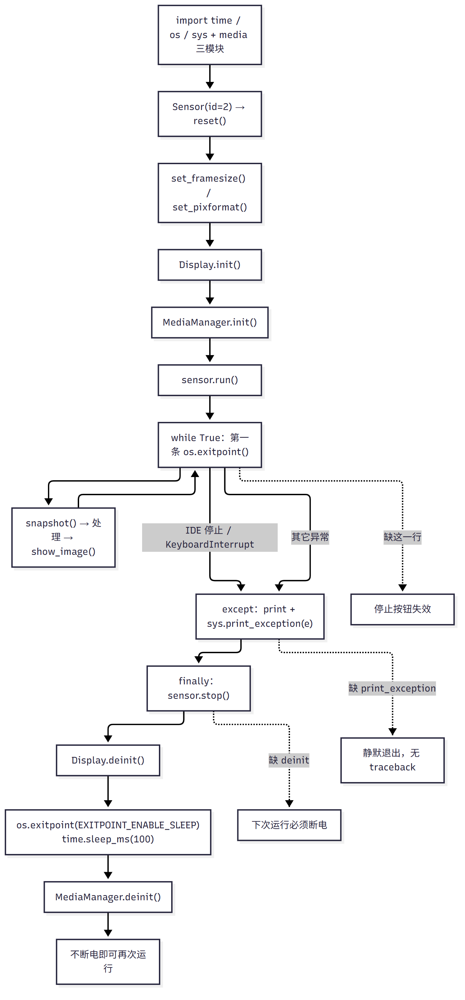

# 上手与环境

面向第一次摸这块板子的人。已用过 CanMV 的，可以只看 [SD 卡目录结构](#sd-卡目录结构) 和 [v1.2 与 v1.3 的区别](#v12-与-v13-的区别) 两节。

## 0. 先确认你的硬件

| | |
| --- | --- |
| 板子 | 立创·庐山派 K230-CanMV（`LCKFB-LSPI-K230-1G`，1 GB） |
| SoC | 嘉楠 K230（另有一款 Lite-K230D，共享同一颗 SoC，外设和内存配置不同） |
| 摄像头 | GC2093，**代码里一律 `sensor_id = 2`**（庐山派默认接在 CSI2） |
| 屏幕 | 板载 **ST7701** 800×480；可外接 **LT9611** MIPI 转 HDMI |

确认自己是哪一款：[K230 与 K230D 的区别](https://openkits-wiki.easyeda.com/zh-hans/lushan-pi-k230/k230vsk230d.html)

> ⚠️ 本仓库**只有立创·庐山派这一块板的引脚信息可靠**。`other_boards/` 里 01Studio、亚博、OpenMV 的例程用的是各自板子的引脚，换板要重新核对。

## 1. 烧固件

从[庐山派快速上手](https://wiki.lckfb.com/zh-hans/lushan-pi-k230/quick-start.html)下载官方 `.img` 镜像，按页面说明烧录（也支持 Web IDE，Chrome 86+）。

**为什么必须用官方镜像，而不是自己拼**：仓库里有大量文件依赖固件自带的模块和资源 ——

| 依赖 | 谁需要 | 从哪来 |
| --- | --- | --- |
| `cv_lite` 扩展模块 | **33 个文件**（`05_cv_lite/` 全部 27 个 + 2025 高精版 + 其它 5 个） | 嘉楠官方模块。⚠️ 它的[文档](https://www.kendryte.com/k230_canmv/zh/v1.5/api/cv_lite/cv_lite.html)从 **v1.4** 才有，v1.3 文档树里查不到；页面注明"请烧录 daily_build 固件"，示例在 `/sdcard/examples/23-CV_Lite/` |
| `/sdcard/examples/kmodel/*.kmodel` | `03_ai_demos/` 需要 18 个 | 官方 SD 镜像 |
| `/sdcard/examples/utils/*.bin` | `03_ai_demos/` 需要 8 个 | 官方 SD 镜像 |
| `ybUtils` 包 | 全仓 8 个亚博例程 | **亚博**固件，庐山派上没有 |
| `/sdcard/examples/15-LVGL/data/` + 思源黑体 ttf | `06_practice/lvgl/` | 官方镜像，可能需自备 |

**30 秒自查你卡上有什么**（在 CanMV IDE 里逐条跑）：

```python
import cv_lite; print("cv_lite OK")             # 失败 = 固件不对，05_cv_lite/ 全部跑不了
import ybUtils                                  # 失败 = 正常，庐山派没有这个包
from libs.PipeLine import PipeLine              # 能导入 = 固件带 v1.2 那套封装
from libs.PlatTasks import ClassificationApp    # 能导入 = 固件带 v1.3 那套封装
                                                # 两个都能导入也正常：v1.3 固件保留了旧接口

# 列目录：os.listdir 和 os.ilistdir 都有；ilistdir 不一次性建列表，更省内存
import os
def ls(p):
    try:
        return [e[0] for e in os.ilistdir(p)]
    except OSError:
        return "<不存在: %s>" % p
print(ls('/sdcard'))
print(ls('/sdcard/examples/kmodel'))            # 数有哪些模型
```

两种 `PlatTasks` 的判断是**启发式**：能导入说明这套封装在；不能导入不等于固件不是 v1.3。真正判断版本，看 IDE 里的固件版本号。

## 2. 连上 IDE

三种方式，任选：

1. **CanMV IDE**（桌面版）—— 最常用，有帧缓冲和帧率显示
2. **VS Code + CanMV 插件**
3. **Web IDE**（Chrome 86+，免安装）

用 USB 线连板子，在 IDE 里选对串口。Windows 是 `COMx`，Linux 是 `/dev/ttyACM0` 或 `/dev/ttyUSB0`。

## 3. 看到第一帧画面

先跑 `01_basics/01_camera_open.py`（关键字拼写已按官方手册修正，见 [P0-3](02_known_issues.md#p0-3)）。

如果它还是起不来，按顺序看 [P0-4](02_known_issues.md#p0-4) 和[已知问题清单](02_known_issues.md)。**不要一上来就改代码**：先确认报错原文。

下面这份是**全仓库唯一推荐的最小模板**。其它目录讲生命周期时都指向这里，不再各写一份：

```python
import time, os, sys
from media.sensor import *
from media.display import *
from media.media import *

sensor = None
try:
    sensor = Sensor(id=2)                    # ← 庐山派的摄像头是 id=2
    sensor.reset()
    sensor.set_framesize(width=800, height=480, chn=CAM_CHN_ID_0)
    sensor.set_pixformat(Sensor.RGB565, chn=CAM_CHN_ID_0)

    Display.init(Display.ST7701, width=800, height=480, to_ide=True)
    MediaManager.init()
    sensor.run()

    clock = time.clock()
    while True:
        os.exitpoint()                        # ← 少了这行，IDE 停止按钮无效
        clock.tick()
        img = sensor.snapshot(chn=CAM_CHN_ID_0)
        Display.show_image(img)
except KeyboardInterrupt as e:
    print("用户停止:", e)
except BaseException as e:
    print("异常:", e)
    sys.print_exception(e)                    # ← 一定带 traceback，否则查不到东西
finally:
    if isinstance(sensor, Sensor):
        sensor.stop()
    Display.deinit()
    os.exitpoint(os.EXITPOINT_ENABLE_SLEEP)
    time.sleep_ms(100)
    MediaManager.deinit()                      # ← 少了这行，跑完必须断电
```

> ⚠️ **有一处官方说法互相冲突，这里如实标出**：嘉楠 v1.3 官方例程的顺序是 `Display.init → MediaManager.init → sensor.run`（本模板和本仓库代码都跟它一致）；庐山派 wiki 的 [`sensor.run` 条目](https://wiki.lckfb.com/zh-hans/lushan-pi-k230/image-recog/use-sensor.html)却写"**必须在调用 `MediaManager.init()` 之前执行**"。两份官方文档矛盾，目前没有上板对照结论。你先按本模板跑；如果固件报错，再按庐山派那个顺序试一次，并把这个结果记进[上板验证记录](02_known_issues.md#上板验证记录)。

## 4. 生命周期契约：为什么"停止后要不要断电"是第一件事

上面的模板里标了 ← 的三行，是 CanMV 上最容易漏、后果最直接的三处：

| 缺什么 | 后果 |
| --- | --- |
| 循环里的裸 `os.exitpoint()` | **IDE 停止按钮无效**，只能靠串口 Ctrl+C 或断电 |
| `finally` 里的 `MediaManager.deinit()` | 媒体缓冲区不释放，**必须给板子断电**才能再跑一次 |
| `except` 里没有 `sys.print_exception(e)` | 程序静默退出，只留一行文字，看不出错在哪 |

**规矩**：任何 `while True:` 的主程序，都必须被 `try/finally` 包住，且 `finally` 里走完整套 `sensor.stop() → Display.deinit() → os.exitpoint(ENABLE_SLEEP) → time.sleep_ms(100) → MediaManager.deinit()`。

⚠️ 区分两个 `os.exitpoint`：**循环里的是无参裸调用**（检查是否请求退出），`finally` 里的是 `os.exitpoint(os.EXITPOINT_ENABLE_SLEEP)`（改变退出时的休眠行为）。它们不是一回事，不能互相替代 —— 批量"补 exitpoint"时最容易搞混。

下面的流程就是模板的结构。三条虚线是三个易漏点各自的后果：



**本仓库现状**：`05_cv_lite/` 全部 27 个文件把清理写在裸 `while True` 之后，**不可达**；另有 3 个文件的 `finally` 被截断在注释处。详见 [P1-4、P1-5](02_known_issues.md#p1-4)。

**学会自查**（10 秒，在仓库根跑）：

```bash
# 缺 MediaManager.deinit() 的
comm -23 <(git ls-files '*.py' | xargs grep -l "MediaManager.init()" | sort) \
         <(git ls-files '*.py' | xargs grep -l "MediaManager.deinit()" | sort)
# 有 while True 但没有裸 os.exitpoint() 的
comm -23 <(git ls-files '*.py' | xargs grep -l "while True" | sort) \
         <(git ls-files '*.py' | xargs grep -l "os.exitpoint()" | sort)
```

## <a name="sd-卡目录结构"></a>5. SD 卡目录结构

板子从 `/sdcard/` 读代码和资源。文档里出现的这些路径**都是板子上的路径**，不是仓库里的：

```
/sdcard/
├── <你的脚本>.py                     ← 从仓库拷过来，建议放根目录或 /sdcard/xxx/
├── mp_deployment_source/             ← ⚠️ 目录名固定，不能改
│   ├── *.kmodel                      模型本体
│   ├── deploy_config.json            部署脚本读它拿参数（仓库里没有这个文件）
│   └── test.jpg                      ⚠️ 不在仓库，跑单图脚本前要自己放
├── test.jpg                          ⚠️ det_image_1_3.py 找的是这里，和上面那个不一样
└── examples/                         ← 官方镜像自带
    ├── kmodel/                       18 个 .kmodel 都在这里
    ├── utils/                        prior_data_320.bin、方向图标 .bin 等
    └── 15-LVGL/data/                 LVGL 示例的字体和图片
```

**两个路径陷阱**：

- `mp_deployment_source/` 这个名字是**承重的**：CanMV 部署代码硬编码 `root_path = "/sdcard/mp_deployment_source/"`。仓库做英文化改名时刻意没动它，同理也没动 `cls_image_1_3.py` / `det_video_1_2_2.py` 这些平台导出件的名字（保持原样才能和平台新导出的包直接 diff）。见 [docs/07](07_maintenance.md#3-不能改名的位置)。
- ⚠️ `deploy_config.json` 被根 `.gitignore` 的一条规则匹配住，**不在版本控制里**；磁盘上也没有。新克隆会拿到 kmodel 但拿不到配置，而脚本开头就读它 → 立刻失败。8 个部署脚本都受影响，见 [P3-2](02_known_issues.md#p3-2)。

**拷贝建议**：直接拷整个 `.py` 文件，或在 IDE 里运行（IDE 会传给板子）。仓库用 ASCII 文件名正是为此 —— FAT32 + CanMV IDE 对非 ASCII 路径的支持在不同版本上表现不一致。

## <a name="v12-与-v13-的区别"></a>6. v1.2 与 v1.3 的区别

**这件事决定你哪些文件能参考、哪些能直接跑。**

| | v1.2.x 写法 | v1.3+ 写法 |
| --- | --- | --- |
| AI 推理 | `from libs.PipeLine import PipeLine`<br>`from libs.AIBase import AIBase`<br>`from libs.AI2D import Ai2d`<br>`import nncase_runtime as nn` | `from libs.PlatTasks import ClassificationApp`<br>`from libs.PlatTasks import DetectionApp`<br>预处理/后处理封在固件里 |
| 代码量 | 手写 ai2d + kpu + softmax，冗长但看得清每一步 | 短约 10 倍，但内部过程看不见 |
| 本仓库哪里用 | `03_ai_demos/` 全部 18 个、`04_number_classification/code/v1.2.2/`、`2025_E_self_aiming/find_rect/det_*_1_2_2.py` | `code/v1.3/`、`det_*_1_3.py` |

⚠️ **`03_ai_demos/` 在 v1.3 上能不能跑，没有结论。** 它用的是 `libs.PipeLine` / `libs.AIBase` / `nncase_runtime` 这一套；嘉楠 v1.3 文档树里仍然保留着 PipeLine、Ai2d、AIBase、Utils 的 API 手册，所以"老 API"不等于"v1.3 一定不支持"。更硬的阻塞是：**它需要的 26 个模型/先验文件一个都不在仓库里**。

- 想**学 API 和推理流程** → 读 `03_ai_demos/`（结构仍有参考价值）
- 想**真的跑 AI** → 用官方 v1.3 例程，或走 `04_number_classification/code/v1.3/`
- 想**看懂 ai2d/kpu 每一步** → 读 v1.2.2 那份，它把细节摊开了

## 7. 版本坑

[CanMV-K230 文档](https://www.kendryte.com/k230_canmv/zh/main/index.html) 左侧有 **v1.2 → v1.7** 的版本选择器，`main` 是开发分支（页面自己写着"可能包含尚未在发布版本中提供的功能"）。你在 v1.3 就切到 v1.3，别照 `main` 抄。

旧的 `developer.canaan-creative.com` 现在跳 `kendryte.com`；厂商 PDF 和老帖子引用的都是旧域名。完整说明见 [04_official_resources.md](04_official_resources.md#6-两个必须知道的坑)。

## 8. 下一步

- 不知道按什么顺序学 → [03_learning_roadmap.md](03_learning_roadmap.md)
- 想知道哪里会咬人 → [02_known_issues.md](02_known_issues.md)
- 要接单片机 → [06_uart_protocol.md](06_uart_protocol.md)
- 要去比赛 → [05_competition_checklist.md](05_competition_checklist.md)
