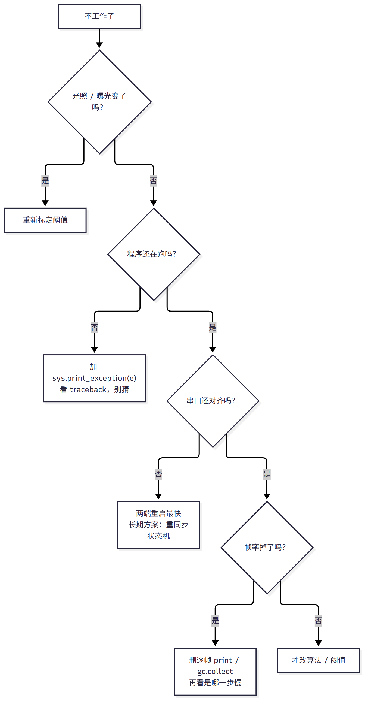

# 赛前检查清单

打印出来带走。每条都对应一处已知问题或一个可复现的故障，不是通用建议。赛场没有网，所以这份要落纸。

---

## 出发前（T-1 周）

### 硬件

- [ ] 主板 + **备用板**（一块板子撑不起 4 天）
- [ ] 备用 SD 卡，**已烧好镜像并验证能启动**（只带空卡 = 现场重烧 = 半天没了）
- [ ] 备用 USB 线、备用摄像头排线（排线最容易松）
- [ ] 备用电池 / 电源，**按云台堵转电流选，不是按标称电流**
- [ ] 打印好的靶标集（多种距离各一套）
- [ ] 打印本清单 + 引脚表 + 串口协议表
- [ ] 纸质笔记本

### 软件

- [ ] `cv_lite` 在你要带走的那张卡上可用 —— 在 IDE 里 `import cv_lite` 试一次（**33 个文件依赖它**，包括 2025 高精版主程序）
- [ ] 所有 `.kmodel` / `.bin` 齐全，**并逐个跑一遍确认**（不是"文件在就行"）
- [ ] 每个 kmodel 旁边都有 `deploy_config.json`。⚠️ 根 `.gitignore` 会把它排除，从 git 克隆出来的一律缺；仓库里也没有这个文件（[P3-2](02_known_issues.md#p3-2)）
- [ ] 单图检测脚本要的 `test.jpg` 已放好 —— `det_image_1_2_2.py` 读 `/sdcard/mp_deployment_source/test.jpg`，`det_image_1_3.py` 读 `/sdcard/test.jpg`，**两个路径不一样**
- [ ] MCU 固件已烧，**且它的串口帧格式和你当天要跑的 K230 脚本逐字节对得上**（仓库里至少 6 族互不兼容的帧，见 [docs/06](06_uart_protocol.md)）
- [ ] **至少三种光照下的阈值已抄在纸上**，不只是存在代码里
- [ ] [已知问题清单](02_known_issues.md)的 P0 级逐条确认过现状：P0-3 已修，P0-1 / P0-2 / P0-4 的现状你知道

### 已知会咬人的点（确认你处理过了）

- [ ] `07_contest/2024_E_tic_tac_toe/main_tic_tac_toe.py` 若要用：**先确认 `os` 可用**。官方模板全部显式 `import os`，这个文件没有（[P0-1](02_known_issues.md#p0-1)）。上板试一次比读文档可靠
- [ ] 你带的 `07_contest/2025_E_self_aiming/result/` 主程序，**先确认它能连续跑 5 分钟不退出**（三个文件各有一到三处读代码发现的崩溃点，其中一个还依赖 `cv_lite`；[P1-6](02_known_issues.md#p1-6)）
- [ ] 触摸调参 UI 的滑块初值和真实阈值一致 —— 否则一进 UI 按保存就会**覆盖掉你标好的阈值**（[P1-2](02_known_issues.md#p1-2)）
- [ ] 要发负值的场合（电机速度），打包用有符号 `'h'` 或偏移编码，不是无符号 `'H'`（[P2-7](02_known_issues.md#p2-7)）
- [ ] `05_cv_lite/` 的示例若要现场反复跑，先补 `os.exitpoint()` 和 `MediaManager.deinit()`（否则每中断一次就要断电；[P1-4](02_known_issues.md#p1-4)）

---

## 到场第一小时

- [ ] 在**赛场真实光照**下跑一遍完整链路，不是实验室
- [ ] **用触摸 UI 重新标定阈值。永远不要带着默认值上场。** 这是 2025 那道题的全部教训
- [ ] 标定完**立刻把数值抄到纸上** —— 保存的值只写进内存里的 list，**重启就没了**，不落盘
- [ ] 对着赛场真实的干扰物，确认嵌套框 / 多条件判别能锁真目标、拒干扰物（⚠️ `main_multi_constraint.py` 那条路径从未运行过，你是第一个跑它的人，预期它会变慢；[P1-1](02_known_issues.md#p1-1)）
- [ ] 和**真 MCU** 端到端验串口，不是回环
- [ ] 确认激光（GPIO48）在正确的状态跳变上触发 —— 既不会该响不响，也不会乱响
- [ ] 确认按停止按钮之后，不用断电就能再跑
- [ ] **演示一次"用默认阈值会失败"** —— 如果不会失败，说明你的标定没起作用

---

## 比赛中

- [ ] 每次保存阈值后**马上抄下来**。回填进 `rect_binary_default/_small/_large` 再拷卡才算固化
- [ ] 程序静默退出时，**第一件事是加 `sys.print_exception(e)`**，在改任何逻辑之前（这份代码里几个崩溃点就是这样长期没被发现的）
- [ ] 光照一变就重新标定：云、太阳角度、场馆灯开关、以及**你把板子挪了位置**
- [ ] 删掉调试 print 之后**重新测一次帧率**（每帧 print + 整帧 hex dump 会实打实吃掉帧率）
- [ ] 换主程序版本时重新调阈值 —— 三个主程序的默认阈值**各不相同**
- [ ] **视觉只是一个子系统。** 结构、电源、MCU 联调都要占时间。别把第三天全花在调一个阈值上
- [ ] 每 2 小时把当前能跑的版本连同阈值数值备份一次（U 盘 + 手机各一份）

### 现场调试的正确顺序

先排除外部条件，再怀疑算法。这张图的顺序就是下面五条：

1. **光照变了吗？** → 重新标定阈值。
2. **程序还在跑吗？** → 加 `sys.print_exception(e)` 看 traceback，别猜。
3. **串口还对齐吗？** → 丢一个字节就永久错位且不自愈；重启两端最快。
4. **帧率掉了吗？** → 删 print / `gc.collect`，再看是 `cv_lite` 还是 `find_blobs` 慢。
5. **最后才是算法 / 阈值本身。**

---

## 备件包

第二块 K230 · 第二张已烧好的 SD 卡 · 第二个摄像头模组 · USB 转串口模块 · 万用表 · 杜邦线 · 胶带和扎带 · 小螺丝刀 · 打印靶标集 · 打印引脚图 · 打印串口协议表 · **纸质笔记本**

---

## 赛后

把这次的实测数据写回仓库：哪个阈值、什么光照、多少帧率、命中如何。写到 [docs/02 的"上板验证记录"表](02_known_issues.md#上板验证记录) —— 那张表现在是空的，每验证一条就加一行。

这份清单里的每条警告都对应一个具体条目。新增了坑，就来加一条。
