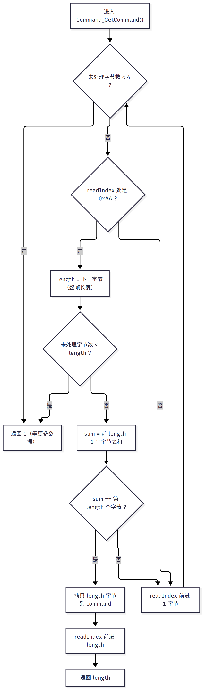

# 串口协议：K230 与对端 MCU

> 这份文件是**串口协议的唯一事实源**。其它文档只写结论并链到这里。
> 依据：仓库代码逐行核对 + 嘉楠 CanMV-K230 v1.3 UART 手册 + 立创庐山派串口教程。行号基于提交 `a2822e9`。

## 0. 先说五条结论

1. **仓库里没有统一协议。** K230 侧自写的帧按字节布局至少能分出 10 族（§2），STM32 侧 4 个工程各解析各的。
2. **唯一自洽的一对**是亚博参考方案：K230 发 `A3 … C3`（大端），亚博 STM32 红端按 6 字节 `…C3` 收。仅此一对。
3. **本仓库自写的 `AA … 55` 帧，没有任何一个 STM32 工程能解析。** 解析器要的是 `AA | len | payload | sum`，没有帧尾；`AA … 55` 的第二字节是 flag（0 或 1），会被当成"整帧长度"。
4. **接收侧几乎都没有重同步。** 全部是"读满 N 字节再校验"，丢 1 个字节就永久错位，直到重启。唯一例外是 2024 三子棋的逐字节 `FF … FE` 扫描（代价是每帧 `time.sleep(0.05)`）。
5. **结论：先定协议，再写两端代码。** 不要指望复用本仓库现成的一段帧格式 —— 它连自己都对不上。

## 1. 硬件与参数（有官方依据的部分）

| 项 | 值 | 依据 |
| --- | --- | --- |
| 串口 | UART2 | 庐山派 [串口教程](https://wiki.lckfb.com/zh-hans/lushan-pi-k230/basic/uart.html)；代码里 `UART(UART.UART2, 115200)` |
| 引脚 | GPIO11 = TX，GPIO12 = RX | 同上；代码里 `fpioa.set_function(11, FPIOA.UART2_TXD)` / `(12, FPIOA.UART2_RXD)` |
| 参数 | 115200，8 数据位，无校验，1 停止位 | 同上 |
| 其它口 | 手册写明 UART0 给小核、UART3 给大核，用户可用 UART1 / UART2 / UART4 | 嘉楠 v1.3 [UART 模块 API 手册](https://www.kendryte.com/k230_canmv/zh/v1.3/api/machine/K230_CanMV_UART%E6%A8%A1%E5%9D%97API%E6%89%8B%E5%86%8C.html) |

代码里的统一写法（仓库里 45 个文件都是这个模式）：

```python
from machine import FPIOA, UART
fpioa = FPIOA()
fpioa.set_function(11, FPIOA.UART2_TXD)
fpioa.set_function(12, FPIOA.UART2_RXD)
uart2 = UART(UART.UART2, 115200)
```

⚠️ 两个**不在官方手册方法列表里**的用法，仓库里却在用：`uart.flush()`（20 多处）和 `uart2.any()`（`06_practice/02_key_switch_ui.py:167`）。能用不等于有文档保证，换固件版本时先测。

## 2. 仓库里出现过的帧族（按字节布局归类）

**这张表按"线上字节长什么样"归类，不是按调用点计数。** 同一族里可能有长度或字节序的变体，已在备注里标出。

| # | 布局（十六进制示意） | 长度 | 谁在发 | 仓库内的接收端 | 能对上吗 |
| --- | --- | --- | --- | --- | --- |
| 1 | `AA <flag> <xH xL> <yH yL> 55` | 7 B | `07_contest/2023_E_laser/main_high_fps.py:145,151`；`07_contest/2025_E_self_aiming/result/` 三个 main；`07_contest/2025_E_self_aiming/methods_reference/iterations/` 7 个；`07_contest/laser_drawing/{01,03,06}`；`06_practice/06_curve_recognition_WIP.py` 逐字节写同一布局 | 无 | ❌ |
| 2 | `AA <flag> <x1H x1L> <y1H y1L> <x2H x2L> <y2H y2L> 55` | 11 B | `07_contest/2023_E_laser/variants/k230_basic.py:62`；`07_contest/laser_drawing/{01,03,06}` 追踪帧；`07_contest/2025_E_self_aiming/methods_reference/error/error2.py:86` | 无 | ❌ |
| 3 | `AA <B + 10×H> 55`（5 个点）<br>`AA <10×H> 55`（无 flag 变体） | 23 B<br>22 B | `07_contest/2023_E_laser/k230_full.py:84`；`07_contest/2023_E_laser/variants/k230_basic.py:84` | 无 | ❌ |
| 4 | `55 AA <轴> <H> FA`<br>`55 AA <10+n> <H> <H> FA`（7 B 变体） | 6 B<br>7 B | 亚博 `07_contest/2023_E_laser/sample_code/{get_square,red_light}.py`；`07_contest/2023_E_laser/variants/{k230_basic_done,k230_entry,k230_pencil_mark}.py`；`07_contest/2023_E_laser/error/error2-4.py` | 无（亚博 STM32 收的是 `A3 … C3`，不是这一族） | ❌ |
| 5 | `55 AA <轴> <H> <轴> <H> FA` | 10 B | `07_contest/2025_E_self_aiming/methods_reference/iterations/cvlite_variant.py:169-178` | 无 | ❌ |
| 6 | `FF <task> <sub> … FE` | 可变 | `07_contest/2024_E_tic_tac_toe/main_tic_tac_toe.py`（`build_frame`，`:139`） | 它自己的 `receive_and_unpack`（`:316` 起） | ✅ 自洽 |
| 7 | `A3 <xH xL yH yL> C3`（大端 6 B）<br>`B3 <4 点 × 4 B + N 点> C3`（变长） | 6 B<br>18+N B | `07_contest/2023_E_laser/yahboom_reference/get_rect.py:92`、`:260` | 亚博红端 `bsp_uart.c`（6 B，`RxBuffer[5]==0xC3`）；`B3` 变长帧无解析端 | ⚠️ 仅 6 B 帧 |
| 8 | `A1 02 <flx> <dx> <fly> <dy> 1A` | 7 B | `other_boards/openmv/2023_laser/{green,red}.py` | 无 | ❌ |
| 9 | ASCII 行：`!x,y@`、`MOVE x y\n`、`P n X.. Y..\r\n`、`DATA,lx,ly,rx,ry\r\n` | 变长 | `07_contest/2023_E_laser` 的 `variants/`、`error/`、`sample_code/`；`other_boards/openmv/nuedc_2025_e/`；`07_contest/reference/basic_gpio/7，用串口发送数据.py`、`8，用串口接收数据.py` | 无 | ❌ |
| 10 | `AA AA <num> <dir> <stepsH> <stepsL> <sum> FF FF` | 9 B | `07_contest/2023_E_laser/basic_part.py:41-49`（步进电机） | 无 | ❌ |

> `06_practice` 里四处 `struct.pack('<BHHHH', 1, x, y)` **不是协议**，是参数个数错（见[已知问题 P0-2](02_known_issues.md#p0-2)），调用即 `struct.error`。

## 3. 发送端 ↔ 解析端：断在哪一步

STM32 侧真正在跑的解析器是 `other_boards/stm32/serial_packet/Core/Src/command.c:104-136`。它期望：

```
AA | len | payload… | sum
 ^    ^                 ^
 帧头  整帧字节数        前 len-1 字节的累加和（低 8 位）
```

**没有帧尾，没有类型字段，没有坐标字段。** 而 K230 自写帧是 `AA | flag(0/1) | x:H | y:H | 55`。

把一帧 `AA 01 00 64 00 C8 55` 喂进去，解析器的走向是：

| 步骤 | 发生什么 |
| --- | --- |
| 取 `len = 0x01` | 把 flag 当成了整帧长度 |
| 长度检查 `GetLength() < 1` | 通过（缓冲区里有数据） |
| 算校验和 `for i < len-1` | `len-1 = 0`，循环一次都不执行，`sum = 0` |
| 比对 `sum` 与 `Read(readIndex + 0)` | `0 != 0xAA` → 前进 1 字节，重新找帧头 |
| 结果 | **整族帧被逐字节丢掉**，解析器不会崩、也不会报错，只是永远返回 0 |

`flag = 0` 的帧更麻烦：`len = 0` 时 `length - 1` 在 `uint8_t` 下溢成 255，校验循环会读 255 个字节（在 128 字节缓冲里绕圈）。绝大多数情况下校验失败、前进 1 字节；**但只要那 255 字节的和偶然等于第 256 个字节，函数就会"校验通过"、拷贝 0 字节、读指针原地不动、返回 0** —— 解析器卡死在同一位置。这是"偶发卡死"类故障，最难查。

## 4. 解析器流程图（对应 `command.c:104-136`）

下面的流程按代码逐行画；括号里是行号。



这套结构本身是对的（找头 → 读长度 → 等齐 → 校验 → 交付），**问题在两端对"长度"的定义不一致**。另外三处边界缺陷（缓冲区 128 但最大只报 127；写满 128 字节后"满"被当成"空"；`writeIndex + length < BUFFER_SIZE` 应为 `<=`）记在[已知问题 P3-1](02_known_issues.md#p3-1)。

## 5. 接收侧为什么必须做重同步

仓库里接收端的标准写法是：

```python
Rxbuf = bytearray(4)
n = uart2.readinto(Rxbuf, 4)
if n is not None and n == 4:
    if Rxbuf[0] == 0x55 and Rxbuf[2] == 0xFF and Rxbuf[3] == 0xFF:
        ...
```

它有两个问题：

1. **丢 1 个字节就永久错位。** 下一轮读到的 4 个字节整体前移，帧头检查再也过不了；因为从不"往回找"，错位会一直保持到重启。
2. **读不满就干等。** `readinto` 会等到 4 字节或超时；对端只发 3 字节时，这一帧被整段丢弃，然后继续等下一段错位数据。

`2023_E_laser/main_high_fps.py:186` 还有个更具体的坑：`bytearray(5)` + `readinto(Rxbuf, 5)` + `== 5`，但协议只有 4 字节 —— 除非串口里恰好多出一个字节，否则这个分支永远不成立。

**正确做法：把"收帧"写成一个带缓冲的状态机**，任何一步失败都只前移 1 个字节重扫，而不是清空重来。下面这份实现在电脑上用 2000 组"随机垃圾 + 随机丢字节"的流验证过：能自愈、不产生假帧、不抛异常（未上板，串口对象是模拟的）。

```python
# 帧格式约定：AA | len | type | payload… | sum | 55
#   len = 整帧字节数（含帧头和帧尾）
#   sum = 从帧头到 payload 末字节的累加和低 8 位
class FrameReader:
    def __init__(self, uart):
        self.uart = uart
        self.buf = bytearray()

    def poll(self):
        """非阻塞：读走串口里已有的字节，返回一帧合法数据或 None。"""
        b = self.uart.read(64)
        if b:
            self.buf.extend(b)
        while True:
            i = self.buf.find(b"\xAA")
            if i < 0:
                self.buf.clear()          # 没有帧头，丢掉全部垃圾
                return None
            if i:
                del self.buf[:i]          # 丢掉帧头之前的字节
            if len(self.buf) < 2:
                return None               # 还看不出长度
            n = self.buf[1]
            if n < 4 or n > 32:           # 长度不合理：这个 0xAA 是假的
                del self.buf[:1]
                continue
            if len(self.buf) < n:
                return None               # 帧还没收齐
            frame = self.buf[:n]
            if frame[-1] == 0x55 and (sum(frame[:n - 2]) & 0xFF) == frame[n - 2]:
                del self.buf[:n]
                return bytes(frame)
            del self.buf[:1]              # 校验失败：只前移 1 字节，重新找头
```

三条规则，换任何协议都适用：

- **失败只前移 1 字节**，不要 `clear()`。清空会把"下一帧的帧头"一起丢掉。
- **先判长度合法性再等收齐**，否则一个假帧头会让接收端等一个永远不来的长帧。
- **校验范围写死**（这里是"帧头到 payload 末"），两端必须用同一张表。

## 6. 自己定协议时的检查单

| 项 | 要定的事 | 常见坑 |
| --- | --- | --- |
| 帧头 | 几个字节、是否可能出现在 payload 里 | 单字节帧头 `0xAA` 很容易撞上；靠"长度 + 校验"兜底 |
| 长度 | 含不含帧头/帧尾/校验 | 两端定义不一致，就是本仓库 §3 的故障 |
| 类型 | 是否需要 task/flag 字段 | 把 flag 放在长度位置（本仓库的错法） |
| 字节序 | 大端还是小端，写死 | `struct` 的 `<` / `>` 必须两端一致 |
| 校验 | 累加和还是 CRC8；覆盖哪些字节 | 只覆盖 payload、不覆盖长度，会让错长度溜过去 |
| 帧尾 | 要不要 | 有帧尾能让"丢字节"更快暴露，但不能替代长度 |
| 重同步 | 失败后前移几字节 | 见 §5 |
| 扩展 | 加字段时旧代码怎么办 | 留 1 字节版本号，或保证新字段只追加在末尾 |

**最重要的一条：把这张表同时写进 Python 和 C 两边的注释里，改一处必须改两处。**

## 7. 主要发帧点索引（谁在哪发）

| 文件:行 | 族 | 用途 |
| --- | --- | --- |
| `07_contest/2023_E_laser/main_high_fps.py:145,151` | 1 | 矩形中心 / 激光点 |
| `07_contest/2023_E_laser/k230_full.py:59,66` | — | **参数个数错，调用即崩**（P0-2） |
| `07_contest/2023_E_laser/k230_full.py:84` | 3 | 5 个点 |
| `07_contest/2023_E_laser/variants/k230_basic.py:62,84` | 2 / 3 | 两点 / 五点 |
| `07_contest/2023_E_laser/basic_part.py:41-49` | 10 | 步进电机 |
| `07_contest/2023_E_laser/yahboom_reference/get_rect.py:92` | 7 | 亚博 6 字节 |
| `07_contest/2023_E_laser/sample_code/red_light.py:79,87` | 4 | 亚博 6 字节 |
| `07_contest/2024_E_tic_tac_toe/main_tic_tac_toe.py:281,293,304,311` | 6 | 坐标 / 棋盘状态 / 复位 |
| `07_contest/2025_E_self_aiming/result/main_thresh_ui_fast.py:436,442` | 1 | 预测点 / 激光点 |
| `07_contest/2025_E_self_aiming/methods_reference/iterations/cvlite_variant.py:169-178` | 5 | 10 字节坐标 |
| `07_contest/laser_drawing/01_triangle.py:58,70,89` | 1 / 3 / 2 | 角点 / 路径 / 追踪 |
| `06_practice/08_color_line_following.py:71` | 1（语义是速度） | 左右轮速度，**负数会崩**（P2-7） |
| `other_boards/openmv/2023_laser/green.py:17` | 8 | 增量坐标 |
| `other_boards/openmv/nuedc_2025_e/激光矩形集中调参/激光矩形集中调参.py` | 9 | ASCII 行 |

完整调用点可以用一条命令重扫（新加文件后跑一遍，别手抄）：

```bash
grep -rn "struct.pack\|bytearray(\[0x\|uart.*\.write(" --include="*.py" . | grep -v "^./NUEDC_TOPIC-master"
```

## 8. 相关

- 缺陷清单：[P0-2 `struct.pack`](02_known_issues.md#p0-2)、[P2-7 无符号速度](02_known_issues.md#p2-7)、[P2-11 收包长度](02_known_issues.md#p2-11)、[P3-1 协议不统一](02_known_issues.md#p3-1)
- 上位机监控：[`pc_tools/README.md`](../pc_tools/README.md)
- 官方：[庐山派串口教程](https://wiki.lckfb.com/zh-hans/lushan-pi-k230/basic/uart.html) · [嘉楠 UART 手册 v1.3](https://www.kendryte.com/k230_canmv/zh/v1.3/api/machine/K230_CanMV_UART%E6%A8%A1%E5%9D%97API%E6%89%8B%E5%86%8C.html)
